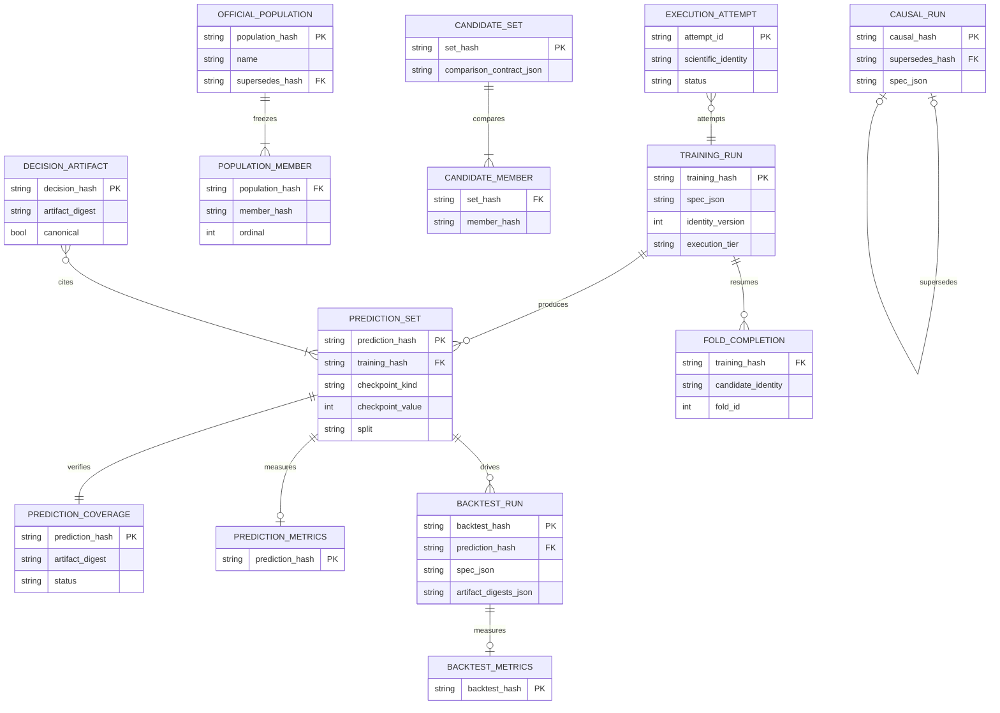
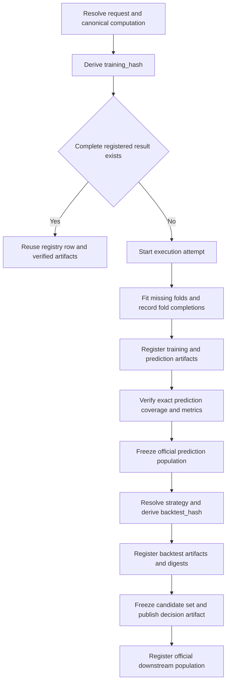

# Artifact Registry, Identity, and Lineage

The **run log** is the persistent system of record for case-study research. Each case study owns one under `case_studies/{case_study}/run_log/`. It records supervised training, predictions, causal estimates, and backtests by semantic identity rather than by launch time or a mutable “latest” pointer. Re-running the same computation can therefore reuse it; changing the computation creates a new identity beside the old one.

This design separates three concerns:

- **SQLite (`registry.db`)** is the catalog and relationship store: identities, specifications, metrics, foreign-key lineage, completeness evidence, named populations, supersession, execution attempts, candidate sets, and decision-artifact metadata.
- **The filesystem** stores large or independently inspectable payloads: model state and `spec.json`, prediction Parquet files, backtest returns/trades/fills/weights/state, decision Parquet files, and digest sidecars.
- **Canonical hashing** binds a resolved computation to its address and binds downstream entities to their upstream address. The database never substitutes for a required artifact, and a file alone is not a registered result.

For the larger research execution context, see [Research Runtime](research-runtime.md). The integrity rationale is developed in [Research Integrity](../concepts/research-integrity.md); operational rerun guidance belongs in [Change and Run Case Studies](../workflows/change-and-run-case-studies.md).

## Core entity model



*The diagram shows identity lineage, completeness records, immutable collections, and execution recovery; population member hashes can refer to training, prediction, or backtest entities according to `member_kind`.*

`training_runs → prediction_sets → backtest_runs` is the main supervised chain. One training identity can yield many checkpoint/split prediction identities; one prediction can drive many strategy variants. `causal_runs` is a side branch because an estimate has no prediction or backtest child. Tables for metrics and fold metrics remain separate from identity rows so measurements can be queried without opening large artifacts.

## Identity is the cache key and the lineage key

All current identities use canonical JSON (sorted keys, compact encoding, finite normalized values) and a 12-hex-character truncation of SHA-256. `ResolvedSpec` requires `identity_version`, schema `ml4t.resolved-spec/v1`, `family`, `label`, `seed`, execution tier, a non-empty `computation`, and separate `provenance`. For identity version 3, only the semantic projection—family, label, seed, tier, and `computation`—enters the training hash. Launch notebook, commit, timestamps, runtime, and other provenance remain recorded but do not fork a computation.

The four primary addresses differ deliberately:

| Identity | Inputs | Meaning |
|---|---|---|
| `training_hash` | Current identity version and resolved-spec schema; `family`, `label`, `seed`, `execution_tier`; the complete canonical `computation` block | One supervised fit specification, including resolved data, fold, preprocessing, model, source-identity, and preview-reduction semantics |
| `prediction_hash` | `training_hash`, `split`, `checkpoint_kind`, `checkpoint_value`, and `identity_version` | One scored checkpoint of one fit on one split |
| `backtest_hash` | `prediction_hash`, `identity_version`, and the reduced canonical strategy specification | One strategy simulation over one prediction set |
| `causal_hash` | A resolved causal specification passed through the same `training_hash_from_spec` projection | One causal computation; its resolved computation includes the estimand, data/folds, and causal runner identity rather than a prediction checkpoint |

Backtest hashing removes non-portable provenance such as `preset_path` and explicitly known serializer defaults that are semantically equivalent to omission. It does **not** generally drop unknown settings: a new non-default strategy setting must produce a distinct address.

### When code changes require a bump

Identity must move whenever behavior that can move registered numbers changes. Linear and GBM use scoped runner/preparation/preprocessing declarations; sequence models separate runner, preparation, persisted state, backend, and architecture; TabM separates runner and state; latent factors separate the shared adapter from each model; causal inference has its own runner version. Increment the narrowest applicable declaration—for example, a TCN-only algorithm change should not invalidate LSTM results.

Use an `identity_version` bump only when changing the **identity scheme or projection itself** across the system. Use a scoped runner/source version when the computation changes within the existing scheme. Refactors, comments, logging, or provenance-only changes need neither. The source-identity tests pin these scopes and prove that a declaration change moves the resulting hash.

## From specification to durable downstream result



*The lifecycle resolves identities before expensive work, reuses only complete state, and freezes explicit downstream membership rather than querying whatever happens to exist.*

A resolved plan can compute all expected hashes without fitting. That makes the registry a cache with a strict acceptance rule rather than a “file exists” shortcut. `training_run_status` requires the training row, at least one prediction row, a prediction artifact, and (by default) a non-null headline metric. `backtest_run_status` requires the backtest row, `daily_returns.parquet`, and measured metrics; a ruined portfolio is considered measured even though its Sharpe is intentionally null. Callers may relax individual requirements explicitly, but partial state is reported as partial and is not silently reused.

Current prediction registration is stronger than the coarse status helpers. It compares the exact expected and actual entity/timestamp/fold keys, checks duplicates, missing and extra keys, null and non-finite scores, fold counts, schema, and a versioned key digest. Registration refuses partial coverage by default. A backtest then refuses ancestry without complete prediction coverage and refuses a canonical/preview tier mismatch.

## Filesystem artifacts and digest evidence

The conventional layout is:

```text
run_log/
├── registry.db
├── training/{training_hash}/
│   ├── spec.json
│   ├── runtime.json
│   └── coefficients.parquet | model.pt | ...
├── predictions/{prediction_hash}/predictions.parquet
├── backtest/{backtest_hash}/
│   ├── spec.json
│   ├── daily_returns.parquet
│   ├── equity.parquet
│   ├── trades.parquet
│   ├── fills.parquet
│   ├── weights.parquet
│   └── portfolio_state.parquet
└── decisions/{decision_hash}/decisions.parquet
```

Stage artifacts written through `write_artifact` receive `<artifact>.digest.json`. Its content digest is based on column names and sorted row hashes, so it is insensitive to row/column ordering and Parquet metadata but sensitive to values. The sidecar also records row count, columns, keys, producer, declared input digests, optional metadata, and optional per-fold digests. Serialization is tested before the Parquet write so an unserializable record cannot leave a new file beside an old sidecar.

Sidecars and registry digests have different scopes. Input sidecars make a stage output self-describing and can be checked by `verify_artifact_sidecars`; ordinary model loading performs the cheap row-count check, while full value verification is opt-in because it re-reads and hashes multi-gigabyte files. If a sidecar is present but disagrees, even the permissive mode refuses it. Training identity independently pins input artifacts in the resolved computation. Prediction coverage stores the prediction content digest, backtest rows store a digest map for all Parquet payloads, and decision rows store their artifact digest; reopening or re-registering refuses disagreement.

## Registration and atomic failure behavior

Current registration treats an existing identity as immutable. Re-registering equal content is idempotent; the same hash with a different semantic row, spec artifact, payload digest, schema, or tier raises an immutable-conflict error. It does not overwrite history to make the conflict disappear.

Atomicity is applied at the boundary where a database row and payload become one result:

- Prediction and decision publication write a uniquely named temporary Parquet file, begin a database transaction, insert identity/completeness metadata, atomically rename the payload, then commit. On failure they roll back and remove a payload moved by that attempt; temporary files are always cleaned.
- Official populations and candidate-set identity/name/member rows are inserted in one transaction and rolled back together.
- Fold-completion records use `BEGIN IMMEDIATE`; a fold is reusable only when both saved paths exist and their SHA-256 digests and resolved settings still match.
- Training specs are atomically written and validated before insertion. A database failure may leave a matching orphan `spec.json`; a later registration adopts only an exact match and rejects conflicting orphan content.
- Backtest artifacts are digest-checked before catalog insertion, and registration refuses to create a backtest row without `daily_returns.parquet`. Matching orphan files can be completed by a later call; conflicting content is never replaced.

This is intentional recovery behavior: failure may leave verified, addressable work available for resumption, but must not leave a catalog row that claims a conflicting or incomplete artifact is reusable.

## SQLite operation: writable WAL versus immutable releases

`_open_registry` is the writer path. It creates/migrates schema, enables foreign keys, selects WAL mode, uses a 120-second driver timeout, and sets `busy_timeout` to 60 seconds so concurrent notebooks and backfills wait for ordinary writer contention rather than immediately failing with `database is locked`.

Readers of a live or workspace registry use `mode=ro` without `immutable=1`. A live file can change and may require WAL recovery; promising immutability would let SQLite bypass locking and miss valid WAL state. Released roots are different: after verification they are read-only and cannot move while open, so catalog readers may add `immutable=1` to avoid locking and sidecar creation. The caller decides immutability; an origin label alone is not sufficient.

A released prediction used by a writable experiment is not copied wholesale. Its registry rows are imported transactionally and `overlay_references` point payload resolution back to the released root. This preserves a small writable overlay while retaining the released artifact as the byte source.

## Official populations, retirement, and preserved history

An `OfficialPopulation` is a content-addressed, named, ordered snapshot of unique training, prediction, or backtest hashes. Canonical populations reject preview results, kind mismatches, and exploratory decision backtests. `require_complete()` verifies that every member exists, has the declared kind, and is whole. Preview execution is barred from writing an official population because populations always live in the canonical registry.

A name is a lineage, not a mutable slot. Reproducing the same member list is a no-op. Publishing a changed list must explicitly identify the current predecessor (or resolve `SUPERSEDES_LIVE` to it); a first generation cannot claim a predecessor. Resolution by name chooses the one generation that no later generation supersedes and rejects a fork. Narrow runs must use a scoped name through the entire chain so a partial snapshot cannot masquerade as canonical.

Retirement is consequently **derived from supersession**, not deletion or recency. Old training, prediction, backtest, population, candidate-set, and causal rows remain because they are evidence for past comparisons and for results that still cite them. A retired prediction is evaluated per population name: one publisher may supersede it while another named frozen snapshot legitimately continues to cite it. Causal rows use the same principle through `supersedes_hash`; selecting “latest by timestamp” is deliberately not a resolution rule.

## Attempts, candidates, and decisions

The execution ledger separates operational attempts from scientific identity. `execution_attempts` records a unique attempt as `running`, then transitions it once to `completed` or `failed` with diagnostics. `candidate_fold_completions` records `(training_hash, candidate_identity, fold_id)` plus fitted-state and prediction-shard paths, digests, settings, and completion time. This permits a retry to reuse completed folds without pretending the failed attempt itself completed.

A `CandidateSet` freezes complete validation results of one kind plus a comparison contract. It rejects mixed protocols unless the differing fields are explicitly declared comparable, preview members, incomplete members, and exploratory decision backtests. Set identity depends on members and contract, while name bindings and supersession are separate: identical members may have several names, and advancing one name does not retire another.

A `DecisionArtifact` binds normalized decisions to exact prediction hashes, parameters, source identity, state-transition policy, artifact digest, tier, and canonical flag. Canonical promotion requires current complete canonical prediction inputs, exact declared lineage, deterministic or seeded execution, and a clean-replay digest equal to the artifact digest. Exploratory decisions may drive exploratory backtests, but those backtests cannot enter canonical candidate sets or official populations.

## Release installation and trust boundary

Run logs are distributed per case study by `scripts/download_artifacts.py`; large bundles may be split into numbered release assets and concatenated before verification. Installation verifies, in order:

1. the downloaded archive SHA-256;
2. that archive paths stay under `case_studies/{case_study}/run_log/` and contain no traversal;
3. every internal file against `.release/SHA256SUMS`;
4. absence of a non-empty uncheckpointed `registry.db-wal`;
5. SQLite `PRAGMA integrity_check` and `foreign_key_check` through a read-only immutable connection.

Only then is the staged tree made read-only and renamed into place. With `--force`, the existing run log is first renamed aside; if the final rename fails, it is restored. Verification or extraction failure never replaces the installed baseline. The resulting baseline must not be mutated; create a writable experiment workspace for new runs.

```bash
uv run python scripts/download_artifacts.py
uv run python scripts/download_artifacts.py --cs etfs
```

## Safe change checklist

- Put every result-affecting input in the resolved `computation`; keep launch provenance outside it.
- Bump the narrowest runner/source declaration when behavior changes; bump `identity_version` only when identity semantics change.
- Register through the shared APIs so exact coverage, tier ancestry, artifact digests, and rollback behavior run.
- Never resolve current state by timestamp or overwrite an old row. Publish an explicit superseding generation.
- Keep preview and narrowed population names isolated from canonical names.
- Treat a row without its required payload, coverage, or metrics as partial, not cached success.
- Use `immutable=1` only for a verified release tree; live WAL-backed databases require normal read-only locking/recovery.

Focused behavior is pinned by `tests/test_registry_completeness.py`, `tests/test_artifact_sidecar_verification.py`, and `tests/test_model_source_identity_versions.py`; broader registry tests cover immutable conflicts, population lineage, atomic publication, and release installation. See [Test System](../testing/test-system.md) for how these protections fit into the repository test layers.
