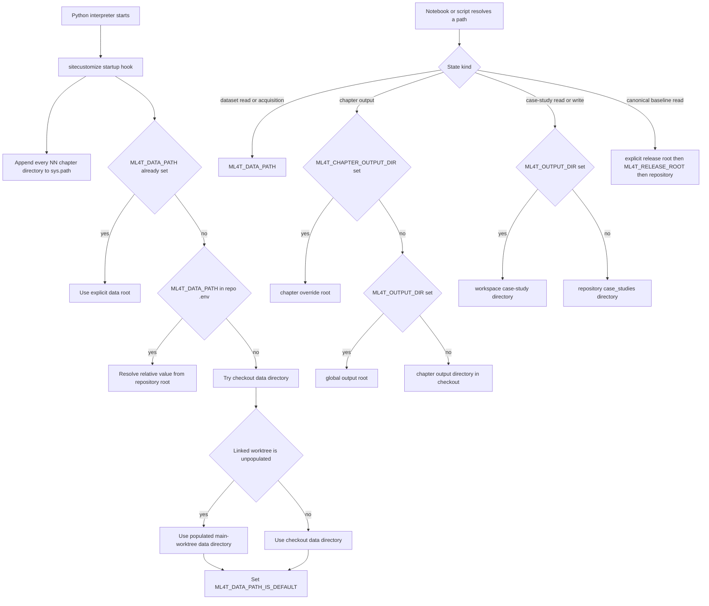

# Data, Imports, and Output Path Runtime

The repository has several kinds of state that must not be confused:

- downloaded datasets under one **data root**;
- source-controlled chapter and case-study configuration under the checkout;
- disposable chapter outputs;
- generated case-study state and experiment state;
- a released case-study baseline used for canonical reads; and
- isolated test outputs and test data.

The runtime centralizes these decisions in [`sitecustomize.py`](../../sitecustomize.py), [`utils/config.py`](../../utils/config.py), and [`utils/paths.py`](../../utils/paths.py). The key safety rule is that the process working directory is not an ownership boundary. Roots are anchored to the repository or explicitly selected, while tests and experiments redirect writes away from published artifacts.

## Resolution and routing at a glance



*The flow separates startup-time data anchoring from per-call read/write routing; chapter-specific output redirection outranks global output redirection.*

## Interpreter startup and repository-root execution

Python automatically imports `sitecustomize` when it is discoverable. This repository ships it as a top-level module in [`pyproject.toml`](../../pyproject.toml), so an editable local installation can load it; Docker exposes the checkout through `PYTHONPATH`. The `uv` configuration prefers a managed interpreter because Debian or Ubuntu may provide an earlier stdlib `sitecustomize.py` that shadows the repository hook.

At startup, the hook finds every directory matching `NN_*` and **appends** it to `sys.path`. Number-prefixed chapter directories preserve reading order but cannot be imported as normal Python package names. Appending lets notebooks use bare imports such as `import async_utils` or `import limit_orderbook` without allowing chapter helpers to shadow standard-library or installed packages. [`tests/test_chapter_imports.py`](../../tests/test_chapter_imports.py) verifies this in a fresh interpreter.

Commands in documentation should still be run from the repository root, for example:

```bash
uv run python data/download_all.py --free-only
uv run python data/futures/market/download.py --estimate-only
```

That convention makes script names, `.env`, and diagnostics predictable. It does **not** mean notebook behavior may depend on `cwd`: Jupyter kernels commonly start in a chapter directory. The startup hook therefore anchors the data root to the checkout, and chapter/case-study helpers derive roots from their source files. [`tests/test_data_root_anchor.py`](../../tests/test_data_root_anchor.py) checks that the repository root, a chapter, `tests/`, and the user's home directory all produce the same data root.

The startup hook is deliberately fail-open: it catches failures rather than making every Python process unusable. If it cannot safely determine a data root, it leaves the variable unset so later configuration loading can still honor `.env`; it never installs a speculative value that `load_dotenv(override=False)` could not replace.

## Data root and `.env` precedence

`ML4T_DATA_PATH` identifies the common root beneath which loaders expect their asset-class layout. Its effective startup precedence is:

1. a non-empty `ML4T_DATA_PATH` already present in the process environment;
2. `ML4T_DATA_PATH` parsed from the checkout's `.env` with `python-dotenv` semantics;
3. `<repo>/data`;
4. only for an unconfigured linked worktree whose local `data/` has no parquet, the populated main worktree's `data/`.

A relative `.env` value is relative to the repository root, never to `cwd`. The linked-worktree fallback is intentionally conservative: merely finding the tracked `data/` skeleton is insufficient because downloaded parquet is ignored. It uses Git's absolute `--git-dir` and `--git-common-dir` to identify the main worktree and borrows its data only when the main tree actually contains datasets. This avoids both a redundant multi-gigabyte download and machine-specific data symlinks that could accidentally be staged.

When step 3 or 4 supplies the answer, startup also sets `ML4T_DATA_PATH_IS_DEFAULT=1`. This is an internal provenance marker, not another root. The test harness must distinguish “startup chose the default” from “the user explicitly selected this directory”; otherwise the tracked but unpopulated source tree can hide a populated test-data checkout and cause data-dependent tests to skip silently. A configured environment or `.env` value is not marked as default.

Importing [`utils/config.py`](../../utils/config.py) loads the root `.env` with `override=False`, so process variables win. If `.env` is missing, configuration attempts to copy `.env.example`; it then resolves `ML4T_PATH` and `ML4T_DATA_PATH`, expands user paths, and fails clearly if either selected path does not exist. The startup hook exists because not every notebook imports `utils.config` before loading data.

Download scripts add one more, intentionally local layer: `resolve_data_dir(cli_arg)` uses an explicit `--data-path` first, then configured `ML4T_DATA_PATH`, then `<repo>/data`. Thus a one-off acquisition can target another disk without changing the runtime's general configuration.

## Loader and acquisition contracts

[`data/__init__.py`](../../data/__init__.py) is the public loader facade. It re-exports asset-specific loaders and the shared `DataNotFoundError`, `DownloadError`, and `MissingDependencyError` types. The common contract is:

- load from the selected `ML4T_DATA_PATH` layout and return a Polars `DataFrame`;
- accept dataset-appropriate symbol/product and date filters, with representative loaders applying filters lazily before collection;
- support deterministic `max_symbols` sampling where provided for test-sized runs; and
- raise an actionable `DataNotFoundError` rather than silently returning empty data. The error names the expected path, effective root and its source, acquisition command or URL, required key where applicable, and a dataset README.

Some loaders have dataset-specific semantics, so callers should not infer more than this shared contract. For example, futures use `products`, and adjusted versus unadjusted ETF prices have different financial meanings. Artifact-sidecar loading is a separate contract: [`utils/artifact_specs.py`](../../utils/artifact_specs.py) reads case-study YAML under the currently routed case-study root, uses the shared `ml4t` spec loader when available, falls back to YAML, caches parsed values, and returns copies so callers cannot mutate cached configuration.

Acquisition is organized by access class rather than one universal downloader:

- **Unauthenticated/free** sources can be orchestrated with `data/download_all.py --free-only`.
- **Free-key or identity-gated** sources require the relevant `.env` value, such as FRED, NASDAQ Data Link, OANDA, or the SEC's real user-agent identity.
- **Paid** Databento downloads should be estimated first. Shared helpers display the charge warning and require explicit acknowledgement unless the caller deliberately forces it.
- **Manual** sources require a provider portal or hosted archive and placement beneath the data root.
- **Convert/unzip** sources arrive as archives and need conversion or extraction into the loader's parquet layout.
- **Repository-licensed** data is a narrow exception to the normal ignore rules.

The orchestrator runs dataset scripts as subprocesses, passes the selected root explicitly, records per-dataset success in an optional JSON report, and exits non-zero if any requested acquisition fails. `--update` refreshes only updateable sources; frozen snapshots remain frozen. See [`data/README.md`](../../data/README.md) for the catalog and provider-specific commands rather than duplicating it here.

### Licensing boundary

Downloaded `data/**` payloads are generally ignored by Git. The explicit exception is the repository copy of AlgoSeek S&P 500 daily bars, redistributed with permission and requiring AlgoSeek attribution. The other documented AlgoSeek datasets are hosted downloads with the same attribution obligations, not permission to commit arbitrary provider archives. Paid Databento and manually obtained data likewise remain local. Safe changes may modify loader code, configuration, documentation, or derived logic, but must not add raw commercial/manual datasets or broaden redistribution based only on local access.

## Chapter output routing

`get_chapter_dir()` resolves the canonical 1–27 registry against the repository root and rejects unknown chapters. `get_output_dir(chapter, strategy_id)` routes non-case-study chapter products as follows:

1. `ML4T_CHAPTER_OUTPUT_DIR`, if set;
2. otherwise `ML4T_OUTPUT_DIR`, if set;
3. otherwise `<chapter>/output/<strategy_id>`.

Redirected directories use names such as `ch07_etfs`; production chapter output uses the chapter's own `output/` directory. Both are generated state. `require_chapter_inputs()` protects chapter pipelines from a dangerous false success: because chapter outputs are gitignored, a fresh checkout has none. Missing earlier-stage products raise `FileNotFoundError` naming every missing path and the notebook that produces it instead of substituting defaults and committing an apparently successful but empty result.

`display_path()` keeps notebook output portable. It first tries paths as written, then resolved paths, so a path reached through a case-study symlink can still display relative to the checkout. For external configured roots it emits placeholders such as `<ML4T_OUTPUT_DIR>/...` rather than committing a maintainer's absolute path.

## Case-study source, release, and writable state

There are three distinct case-study concepts:

- `get_case_study_source_dir(strategy_id)` finds source-controlled assets, preferring a sibling `dev/case_studies/<id>` when it exists and otherwise using `<repo>/case_studies/<id>`.
- `get_case_study_dir(strategy_id)` is the runtime route for configs and artifacts. It returns `ML4T_OUTPUT_DIR/<id>` when redirected and otherwise `CASE_STUDIES_DIR/<id>`.
- a `Study` also has a **release root** for canonical baseline reads. An explicit `release_root` argument wins, then `ML4T_RELEASE_ROOT`, then `REPO_ROOT`.

This distinction matters because setting `ML4T_OUTPUT_DIR` redirects configuration reads as well as writes. [`scripts/create_experiment.py`](../../scripts/create_experiment.py) therefore creates a complete writable experiment: it stages available generated directories, copies per-case configuration and shared presets, makes the copy writable, converts release metadata to baseline metadata, and finalizes with renames. It refuses an existing target and validates that required installed artifacts/configuration exist.

Opening or activating a writable `Study` points `ML4T_OUTPUT_DIR` at its workspace. Preview runs route beneath `.preview/<case-study>` and link committed read-only inputs such as config, labels, features, and benchmarks while creating their own registry. Read-only studies reject writable storage. A canonical run that is given a workspace must write there; it must never read private state and silently register results in the published store.

`ML4T_ENTRY_POINT` carries notebook identity across launch boundaries. Its precedence is an explicit `entry_point` argument, then the environment, then `None`. The value is normalized to a basename stem by dropping directories and a `.py` or `.ipynb` suffix. The runtime does not infer it from frames or `__file__`, because Papermill executes a temporary notebook and does not expose the original notebook identity to the kernel. Launchers that know the notebook set the variable so registered training runs retain provenance.

## Why tests must never write production artifacts

The pytest harness establishes isolated roots, not merely smaller computations:

- data resolution ignores `ML4T_DATA_PATH` when `ML4T_DATA_PATH_IS_DEFAULT` marks it as an unchosen startup fallback, then looks for configured or well-known populated test data;
- `ML4T_OUTPUT_DIR` points every case-study write and, absent a chapter-specific override, chapter writes into a temporary/worker-specific root;
- `ML4T_RELEASE_ROOT` points canonical reads at a checkout-shaped test release rather than a maintainer's symlinked published registry;
- fixture state is replaced rather than merged, preventing rows and artifacts from earlier local runs from contaminating a test.

This is correctness, not cleanup. A test that reaches production `case_studies/<id>/run_log`, `features`, or `labels` can silently alter registries and published identities while still passing. [`tests/test_paths.py`](../../tests/test_paths.py) pins output precedence and directory creation semantics. [`tests/test_canonical_workspace_routes_writes.py`](../../tests/test_canonical_workspace_routes_writes.py) checks every local `open_study` implementation and every notebook call site so canonical workspace runs cannot escape to released storage. The broader test setup in [`tests/conftest.py`](../../tests/conftest.py) supplies worker-isolated output and release roots.

## Safe extension checklist

When adding a dataset, loader, chapter helper, or artifact producer:

1. expose loaders through `data` only after they honor the selected root and fail with actionable acquisition guidance;
2. use shared download argument/path helpers, preserve CLI-over-environment precedence, and return non-zero on incomplete acquisition;
3. classify the provider as free, keyed, paid, manual, converted, or repository-licensed before changing ignore or redistribution rules;
4. use `get_output_dir()` for disposable chapter products and `get_case_study_dir()` or `Study.storage_root()` for case-study state—never construct production paths from `cwd`;
5. pass a workspace decision explicitly when opening a writable study;
6. add a numbered chapter helper as a uniquely named module, because startup exposes chapter directories in one flat import namespace; and
7. test with redirected data, output, chapter-output, and release roots so no test depends on or mutates a maintainer's machine state.

For the wider repository boundaries, see [Repository System](repository-system.md), [Research Runtime](research-runtime.md), [Test System](../testing/test-system.md), and [Change and Run Case Studies](../workflows/change-and-run-case-studies.md).
