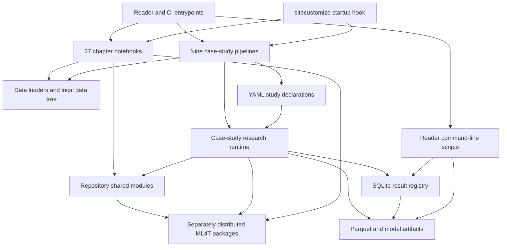

# Repository System and Ownership Boundaries

This repository is a **teaching and research-integration system**, not the implementation home of the entire ML4T stack. It owns the 27 chapter narratives and executable examples, the nine longitudinal case-study pipelines, their declarations and experiment registry protocol, repository-local adapters and utilities, data acquisition and loading entrypoints, execution environments, and reader-facing operational scripts. The packages named `ml4t-data`, `ml4t-engineer`, `ml4t-models`, `ml4t-diagnostic`, `ml4t-backtest`, and `ml4t-live` are separately distributed dependencies. Their reusable provider integrations, feature and label algorithms, finance-native models, diagnostics, event-driven engine, and live broker runtime are consumed here through public imports; they are not reimplemented or released from this source tree.

That distinction matters when making a change. A notebook, case-study policy, adapter, or artifact contract belongs here. A generally reusable fix to `ml4t.live.SafeBroker`, `ml4t.backtest.Engine`, an `ml4t.engineer` feature, or an `ml4t.models` estimator belongs in that package, followed by a dependency-version update and integration change here.

## Architectural domains

The numbered directories are presentation order, not Python package boundaries. At interpreter startup, [`sitecustomize.py`](../../sitecustomize.py) appends each `NN_*` chapter directory to `sys.path` so chapter helper modules remain importable despite number-prefixed directory names. It also anchors `ML4T_DATA_PATH` independently of the kernel's working directory. Repository-level packages (`data`, `utils`, `case_studies`, and `scripts`) are installable, while chapter helpers remain a deliberately flat teaching surface.



*Major runtime domains and dependencies exposed by the repository's entrypoints and public imports.*

### Teaching chapters

Each of the 27 chapter directories pairs prose-oriented, executable Jupytext scripts with rendered notebooks and a chapter guide. Most chapter examples can be approached independently: they demonstrate a book concept against downloaded data and use repository utilities or public ML4T APIs as needed. They are not 27 deployable services, nor should their directory sequence be mistaken for runtime layering.

The repository owns the examples, pedagogical sequencing, local helper modules, expected render, and environment in which an example is validated. It does not thereby take ownership of algorithms called from an installed library. For example, chapter code imports metrics from `ml4t.diagnostic`, labeling and feature functions from `ml4t.engineer`, and backtest types from `ml4t.backtest`.

### Longitudinal case studies

The nine case studies are pipelines rather than independent demonstrations. Each applies the same phase order—feasibility, labels, features, model families, model analysis, backtest, portfolio, costs, risk, and synthesis—to a different market. Stage numbers vary because not every market uses every model family, but later stages consume artifacts produced by earlier ones.

The repository owns this orchestration layer:

- `case_studies/{id}/config/` declares the market-specific study and model population.
- `case_studies/research` exposes the study, planning, resolution, execution, population, selection, decision, and result contracts used across studies.
- `case_studies/utils` contains repository-specific runners, adapters, artifact handling, analytics, notebook contracts, and strategy-analysis support.
- Per-case-study generated state records what this repository's declared experiment produced.

This is more than notebook glue. A model request is resolved against concrete feature and label files, fold boundaries, eligible rows, implementation identity, and runtime versions before fitting. Its canonical identity is content-addressed. Training, prediction, and backtest identities then form a traceable chain, allowing completed work to be reused and interrupted populations to resume without treating “whatever files exist” as a complete experiment. See [Research Runtime](research-runtime.md) for that lifecycle and [Artifact Registry](artifact-registry.md) for the persistence model.

### Shared modules versus scripts

`utils` is imported library code: configuration and path resolution, styling, data-quality checks, artifact declarations, modeling helpers, cross-validation, caching, and reproducibility. `case_studies/utils` is narrower and owns the case-study execution adapters and analysis mechanics. `case_studies/research` provides the higher-level domain API through `open_study`, plans, requests, populations, catalogs, and results.

`scripts`, by contrast, is a small reader-operated command surface. Its supported entrypoints verify an installation, synchronize notebook pairs, download released artifacts, and create isolated experiments. CI repair and provenance-maintenance tools live under `.github/scripts`, while private registry migrations and one-off maintenance are explicitly outside this repository. Do not move reusable runtime behavior into `scripts` merely because a notebook needs to call it.

## What is owned here and what is delegated

| Capability | This repository owns | Delegated package owns |
|---|---|---|
| Data | Dataset catalog, download/conversion commands, local loaders and paths, dataset cards, teaching snapshots, case-study data declarations | `ml4t-data`: reusable acquisition interfaces and provider-specific market-data behavior |
| Features and labels | Notebook choices, case-study feature assembly, point-in-time pipeline policy, generated feature and label artifacts | `ml4t-engineer`: reusable features, labels, bars, preprocessing, and leakage-safe preparation primitives |
| Models | Declared model menus and presets, adapters, folds, run identity, orchestration, local persistence and comparisons | `ml4t-models`: reusable latent-factor, SDF, forecasting, asset-prediction, and portfolio-learning implementations |
| Evaluation | Which diagnostics support a chapter or selection decision, storage of resulting metrics, repository analytics | `ml4t-diagnostic`: reusable metrics, splitters, validators, statistical diagnostics, and visualization APIs |
| Simulation | Strategy declarations, sweep grids, case-study integration, accepted backtest records and artifacts | `ml4t-backtest`: reusable event-driven engine, orders, positions, execution modes, and simulation semantics |
| Deployment | Teaching deployment loops, replay comparisons, example broker configuration, operational notebooks | `ml4t-live`: live engine, feeds, brokers, safety wrappers, risk state, and broker reconciliation behavior |

The boundary is visible in packaging: [`pyproject.toml`](../../pyproject.toml) declares all six distributions as dependencies, while setuptools discovers only the repository-local `utils`, `data`, `case_studies`, and `scripts` packages plus `sitecustomize`. Public imports in chapter 25 connect repository demonstrations to `ml4t.backtest`, `ml4t.live`, and `ml4t.engineer`; latent-factor adapters similarly bridge to `ml4t.models`. These imports are integration contracts, not evidence that the package implementation is vendored here.

## Sources of truth and generated surfaces

“Source of truth” is scoped by concern. No single tree is authoritative for authoring, study intent, accepted results, and binary payloads at once.

| Surface | Authority | Lifecycle and safe-change rule |
|---|---|---|
| Jupytext `.py` | Authorial source for notebook code and markdown | Edit this file. Regenerate the paired `.ipynb`; content-based checks compare code and prose rather than unreliable mtimes. |
| Rendered `.ipynb` | Viewable, executable render and committed output surface | It may contain outputs, execution metadata, Papermill-injected parameters, and provenance. It is generated from the `.py`, not an independent code source. Reverse drift is stopped for manual review so notebook-only work is not silently overwritten. |
| `config/setup.yaml` | Declared case-study universe, decision and execution protocol, costs, labels, CV, and strategy sweep | Version-controlled input. Per-label training YAML selects named model configurations; shared preset YAML provides reusable hyperparameters. Resolution binds declarations to current files, folds, rows, and implementation versions. |
| `run_log/registry.db` | Accepted result and provenance catalog | The only result source of truth for training runs, prediction sets, populations, causal estimates, backtests, and metrics. A file on disk is not accepted merely because it exists. |
| Parquet, coefficients, boosters, checkpoints, returns, trades, and weights | Generated payload for a registered identity | Stored under content-addressed training, prediction, and backtest directories and referenced by registry rows. They are reproducible products, not declarations; registry-to-file identity and release checksums bind them to accepted results. |
| `data/` | Tracked acquisition/loading code, configuration, cards, and a small set of licensed or release inputs | Most downloaded parquet data is external state and gitignored even though the tracked directory skeleton exists. Existence of a directory does not prove a dataset is installed. |
| `benchmark/` in a case study | Versioned release input for downstream comparison | Equal-weight reference returns and metadata are read by strategy analysis; they are not model-run outputs inferred from arbitrary current registry contents. |

The notebook pair has one directional default:

```text
Jupytext .py  --sync/render/execute-->  .ipynb with outputs
```

`scripts/sync_notebooks.py --check` reports drift without writing. Normal synchronization proceeds from `.py` to `.ipynb`; if the notebook is newer, the script refuses to overwrite it and asks for manual reverse conversion and review. Code changes against a rendered notebook with outputs also imply that those outputs may be stale; syncing structure is not a substitute for re-execution. See [Editing Notebooks](../workflows/edit-notebooks.md).

The research chain has a different authority flow:

```text
YAML declarations + data and feature digests + folds + implementation identity
    -> resolved training identity
    -> registered prediction identity
    -> registered backtest identity
    -> generated files addressed by those identities
```

Changing YAML, features, labels, folds, or result-affecting implementation identity creates a new hash and a new result beside the old one. It does not mutate history in place. Immutable named populations prevent a partially completed or later-redefined set from masquerading as the population downstream analysis intended to compare.

## State, installation, and experiment boundaries

Released case-study bundles are installed as read-only baselines. The downloader verifies the outer archive hash, constrains extraction to the expected case-study run-log path, verifies each internal checksum, rejects an uncheckpointed SQLite WAL, checks SQLite integrity and foreign keys, and then atomically replaces the target. A corrupt or interrupted install therefore does not become the active baseline.

Writing starts in an isolated experiment. `scripts/create_experiment.py` copies available generated prerequisites and case-study configuration into a new `ML4T_OUTPUT_DIR`, makes the copy writable, and renames release metadata to baseline metadata. `open_study(..., workspace=...)` creates or validates the workspace manifest and routes path-sensitive caches and registry writes to it. A study opened without a workspace is read-only and rejects writes; preview runs are further separated under `.preview/` and cannot be published as canonical populations.

This separation is an operational invariant, not only a convenience: downloaded results remain a stable reference, experimental configuration lives with experimental outputs, and analysis can distinguish released, canonical workspace, and reduced preview state. For path precedence and worktree behavior, see [Data and Path Runtime](data-and-path-runtime.md). For initial commands, see the [Quickstart](../quickstart.md).

## Runtime invariants and common failures

- **Start from the repository root or provide absolute roots.** Jupyter kernels use a notebook's directory as `cwd`; `sitecustomize` and `ML4T_DATA_PATH` prevent that detail from relocating datasets. A user-provided environment value wins, then `.env`, then the repository default.
- **Startup customization must not break Python.** `sitecustomize` catches failures and leaves the data variable unset rather than setting an uncorrectable guess. Installation verification checks that the hook actually loaded.
- **A tracked data directory is not an installed dataset.** Loaders raise `DataNotFoundError` with the relevant acquisition instruction when payloads are absent.
- **Do not infer completeness from artifacts.** Downstream comparisons consume registered, immutable populations. A failed population run preserves completed configurations but does not publish the incomplete population name.
- **Do not write to the released run log.** Use an experiment or workspace. Read-only studies enforce this in the domain API, and downloaded filesystem state is made read-only as a second boundary.
- **Treat implementation identity as part of cache correctness.** A numerical behavior change in a runner or adapter must update the scoped version or source identity used by the resolved spec; otherwise stale cached results could be returned as current.
- **Keep package fixes at the correct boundary.** Repository adapters may normalize study-specific shapes, but copying a package implementation locally creates two semantics and bypasses the dependency contract.

## Extension guide

Choose the extension point by the kind of change:

1. **Add or revise teaching material:** edit a chapter's Jupytext `.py`, use repository helpers or public package APIs, regenerate the `.ipynb`, and re-execute when code invalidates outputs.
2. **Change a case-study experiment:** create an isolated experiment, edit its `setup.yaml`, training menu, or shared preset copy, and run the affected stage. Expect a new content identity.
3. **Add a model family to case studies:** implement the repository adapter and identity scope, expose planning/execution through `case_studies.research`, add presets and menus, and test resolution, cache identity, leakage boundaries, persistence, and restart behavior.
4. **Add a dataset:** keep download/conversion and loader behavior in the local data domain when it is book-specific; contribute reusable provider acquisition to `ml4t-data`. Document licensing and ensure absence fails with an actionable command.
5. **Change reusable finance behavior:** modify the owning external library, publish a compatible version, update `pyproject.toml`, and validate representative notebook and case-study integrations here.

Focused guards reflect these boundaries: notebook tests cover prose/code drift; data-root tests cover startup anchoring; artifact-downloader tests cover archive safety and atomic verified installation; experiment and workspace tests cover write routing; identity tests pin result-affecting runner scopes; and case-study workflow tests exercise planning, population publication, registry reuse, and downstream analysis. The safest review question is therefore not “which directory changed?” but “which authority or ownership contract changed, and which integration test proves the boundary still holds?”
