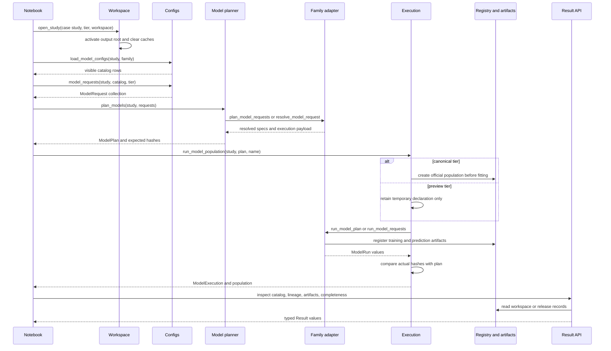
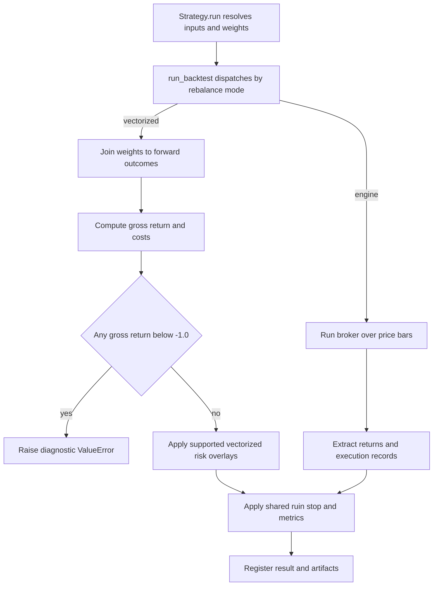
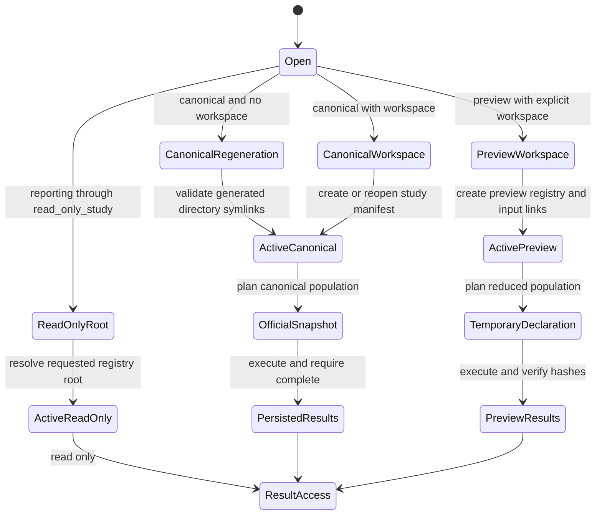

# Case-Study Research Runtime

The research runtime is the boundary between a notebook's declarative intent and persisted, identity-addressed research artifacts. A notebook names a case study, execution tier, model family, label, and configuration; the runtime resolves those names against data, cross-validation, checkpoints, and input lineage before it computes anything. It can then declare the expected model population, invoke family-specific adapters, execute strategies, and return typed result objects backed by registry rows and files.

This architecture supports the integrity rules described in [Research Integrity](../concepts/research-integrity.md) and builds on the registry described in [Artifact Registry](artifact-registry.md). Operational sequencing belongs in [Change and Run Case Studies](../workflows/change-and-run-case-studies.md).

## Ownership boundaries

| Boundary | Owning module | Responsibility |
|---|---|---|
| Public API | `case_studies/research/__init__.py` | Re-exports the supported notebook-facing surface, including `open_study`, requests, planners, executors, and result types. |
| Workspace and path state | `workspace.py` | Opens canonical, isolated, preview, regeneration, and read-only studies; activates process-global path routing. |
| Declared configuration | `configs.py` | Reads setup labels and training menus, produces visible catalogs, and converts catalog rows to `ModelRequest` objects. |
| Request contract | `models.py` | Validates unresolved requests, delegates resolution and execution to family adapters, and validates resolved-spec invariants. |
| Adapter registry | `adapters.py` | Maps `(kind, name)` to lazily imported implementation modules. |
| Population planning | `model_planning.py` | Resolves identities and checkpoint membership without fitting; groups work by family and preserves request order. |
| Execution orchestration | `execution.py` | Runs models and backtests, declares official populations, verifies produced identities, and reports computed versus reused work. |
| Strategy resolution | `strategy.py` | Turns a complete prediction plus signal, allocation, risk, cost, and price inputs into an identity-bearing backtest specification. |
| Backtest mechanics | `case_studies/utils/backtest_runner.py` | Converts resolved strategy inputs to weights, dispatches vectorized or broker-aware execution, computes return metrics, and registers successful runs. |
| Result access | `results.py` | Resolves hashes across workspace and release registries and exposes registry records, specs, artifacts, lineage, protocol, and completeness. |
| Notebook-level admissibility | `case_studies/utils/notebook_contracts.py` | Applies reporting and selection safeguards such as excluding degenerate or incomplete prediction sets. |

The adapter boundary is intentionally narrow. Built-ins register `linear`, `gbm`, `deep_learning`, `tabular_dl`, `latent_factors`, and `ensemble` model names, plus the `dml` causal adapter. `get_adapter()` imports a module only when needed. A model adapter may provide scalar hooks such as `resolve_model_request` and `run_resolved_request`, and may optimize a family with `plan_model_requests`, `run_model_plan`, or `run_model_requests`. The generic runtime validates counts, tiers, family and label stability, and returned types around those hooks.

## From declaration to a resolved model plan

Configuration is layered rather than copied into notebooks:

1. `config/setup.yaml` declares the primary label and sweep variants.
2. `config/training/<label>.yaml` declares which configuration names belong to each family for that label.
3. Shared preset files under the case-studies `config/<model-type>/` directories provide model class, library, and parameters. `utils.modeling.load_configs()` enriches them with filesystem-derived `config_name`, family, and library.
4. `load_model_configs()` produces one visible Polars row per `(family, label, config_name)`. Optional label or configuration filtering is strict: unknown requested names and empty selections fail instead of silently narrowing a run.
5. `model_requests()` converts only those identity columns into unresolved `ModelRequest` objects, adding explicit overrides, a `CVSpec`, tier, preview reductions, and notebook provenance where supplied.
6. The family resolver combines the preset and overrides with the actual dataset, label artifact, resolved CV folds, eligibility keys, checkpoint schedule, and provenance. The resulting `ResolvedModelRequest.spec` is the hashable statement of what will be computed; its in-memory context carries prepared inputs needed to run it.

`ModelRequest.from_request()` rejects unknown fields and unsupported families. Preview requests must state non-empty `preview_reductions`; canonical requests must not carry them. Resolution also refuses an adapter that changes the requested family, label, or execution tier, or that emits an unsupported identity version or the wrong current resolved-spec schema. These checks keep adapter implementations behind one uniform contract.

Planning is preferred for a population. `plan_models()` requires at least one unresolved request, one study, and one tier. It groups requests by family, invokes a batch planner where available, and otherwise resolves each request. From each resolved specification it derives the training hash and every checkpoint prediction hash without fitting. Duplicate training or checkpoint identities are refused. `planned_model_plan()` exposes the resulting computation dimensions without retaining all eligible entity keys, which matters when prepared folds are too large to hold once per configuration.

*Representative model-population run: declaration and expected identities precede adapter execution, and produced identities are checked before results return.*

### Population guarantees and failures

`run_model_population()` is the tier-neutral notebook entry point. Both tiers declare all expected prediction hashes before the first fit and compare the produced multiset with that declaration. A `ModelPlan` should be passed directly after it has been displayed; passing its underlying requests would discard the family payload and repeat planning.

For canonical requests, `run_official_models()` persists an `OfficialPopulation` before execution and requires it to be complete afterward. A changed member set under an existing name requires the exact predecessor through `supersedes`; this records lineage rather than silently replacing an immutable snapshot. For preview requests, the runtime returns an in-memory `PreviewPopulation`. It cannot create an official population or supersede one, and every request must carry reductions in its identity.

A plan cannot mix tiers, requests from another study, duplicate identities, or an adapter result count different from the submitted count. Execution preserves original request order even though dispatch is grouped by family. After adapters return, planned execution checks both training hashes and checkpoint prediction hashes exactly. The returned `ModelExecution` includes runs, matching catalog rows, and per-run diagnostics.

`run_models()` is the lower-level route for ad hoc requests. It uses a family batch runner when available, otherwise resolves and runs each request. The batch and individual paths are contractually expected to produce the same training identities, prediction identities, and data.

## Backtest path

Backtesting starts from authoritative Polars rows selected from `study.predictions`, not from an arbitrary prediction file. `plan_backtests()` validates and resolves each selected row to a `PredictionResult`, constructs a `Strategy`, resolves prices and case-specific defaults, and hashes the serializable strategy specification with the prediction identity. A plan cannot mix canonical and preview predictions.

`Strategy` requires a complete prediction from the same study and a validation or holdout split. Its resolved specification includes signal, allocation, risk, costs, input-price identity, execution tier, and case-specific behavior. Holdout strategies must load canonical holdout prices rather than accept reader-supplied prices.

`run_backtests()` requires a writable study and validates the entire selection before executing. Canonical backtests create an official population before writes; preview or exploratory ancestry cannot do so. Each member is reused if `Result.open()` finds a complete result with the planned hash, otherwise the strategy runs. A returned hash that differs from the plan is fatal, and an official population must be complete at the end. `BacktestExecution.diagnostics`, `n_computed`, `n_reused`, and `disclosure()` make warm-registry reuse explicit rather than presenting a cached sweep as newly computed work.

### Vectorized refusal versus broker-aware execution

`Strategy.run()` loads the prediction and price frames, resolves any decision or state-transition weights, and calls the shared `run_backtest()` boundary. The canonical strategy specification's `strategy.rebalance.mode` then chooses the ordinary vectorized or engine path; the specialized options hold-to-expiry path is a separate dispatch and should not be inferred from the rules below.

The ordinary vectorized path is deliberately an arithmetic return path, not a broker simulation. It thins predictions to rebalance dates, joins target weights to realized forward outcomes, computes each period's `gross_ret` as `sum(weight * y_true)`, calculates turnover and costs, and only later applies supported portfolio-level risk overlays. Because it has no intra-period position, broker, margin, or fill state, a short leg can make that product less than `-1.0` even when the account configuration forbids leverage and declares short maintenance margin.

After the canonical-window slice, `_run_vectorized()` now refuses every period whose **gross** return is strictly below `-1.0`. It raises `ValueError` before vectorized risk overlays, daily-return construction, metric calculation, and `run_backtest()`'s registry/artifact write block. The message is part of the operational diagnosis: it reports the case study and label, affected-period count and total period count, worst gross return, and up to three largest negative symbol/timestamp contributions with their weight and `y_true`. Callers should preserve that complete exception rather than replacing it with a generic failed-member count.

This guard is not a liquidation, maintenance-margin, or loss-capping model. It does not choose an intra-period liquidation price, rewrite the period to `-100%`, or continue the vectorized run. It is also narrower than cumulative ruin handling: the predicate is `gross_ret < -1.0` for one period. If a valid return path reaches zero through other losses, shared post-execution ruin semantics stop the persisted return series at `-100%`, set later returns to zero, and make ranking ratios unrankable.

The engine branch instead builds a `DataFeed`, broker-backed strategy, target-weight executor, configured position rules, and portfolio risk manager. It advances over price bars, holds positions between rebalances, and can return trade, fill, equity, and portfolio-state records. Extracted engine returns still pass through the same ruin-stop and metric layer, but the vectorized insolvency refusal is not applied to engine output.

*Backtest execution diverges at the resolved mode: the vectorized path refuses an impossible one-period gross loss before registration, while the engine path obtains returns from broker-aware position execution.*

#### Failure propagation and remediation

The refusal escapes `Strategy.run()` and `run_backtests()`; the sweep does not return a `BacktestExecution`, and no per-member `diagnostics` entry is appended for the failed member. In a canonical run, the official population was already declared before member execution, so it remains incomplete rather than being silently redefined around the successful members. Any earlier members that completed remain identity-addressed and can be reused on a retry.

Treat the exception's named contributions as evidence about the strategy/data combination. The supported remedies are to bound or remove the short exposure before weights are computed, or change the strategy to the engine path so positions are priced through broker state. Do not catch the error and clamp the return, inject a synthetic liquidation, drop the offending outcome, or renormalize only the survivors: those changes would manufacture behavior the vectorized path cannot observe. Because a signal or execution-mode correction changes the strategy specification and backtest identities, replacing a canonical population under the same name must follow the normal `supersedes` lineage rule.

Focused helper tests use observed extrema from the `us_firm_characteristics` monthly-return panel. A `-0.5` short against the observed maximum forward return must raise with the insolvency diagnosis, while a fully invested long fixture at the panel's observed minimum remains above `-1.0` and completes. These tests pin both the refusal and its scope; they do not assert a vectorized margin or liquidation implementation. Broader population-before-write, retry-reuse, and completeness behavior remains covered by the research execution tests described below and in [Test System](../testing/test-system.md).

## Workspace and tier lifecycle

The terms describe different axes:

- **Canonical** is a computation tier. With no workspace, `open_study()` enters the maintainer regeneration path and writes through required `features`, `labels`, and `run_log` directory symlinks. With a workspace, the same full computation writes to an isolated case directory instead of the release.
- **Preview** is a reduced computation tier. It requires an explicit workspace and declared reductions. Its writable registry lives under `<workspace>/.preview/<case-study>`. Configuration and immutable inputs are linked in, while preview training, predictions, and backtests remain isolated.
- **Read-only** is a write capability, not a tier. `read_only_study()` resolves the canonical or preview registry to report on and activates path helpers without permitting publication. `Study.at()` is the single-root primitive; mutating APIs call `require_writable()`.
- **Release overlay** is read behavior for a writable workspace. `Result.open()` searches the workspace's canonical registry first, then the released case-study registry, and optionally the preview registry. Thus notebooks can use released canonical results without copying the release `run_log`, while workspace results with the same identity take precedence. Released predictions selected for a workspace backtest have the needed registry rows copied into the workspace and retain references to their source root.

*Workspace and tier transitions: canonicality governs identity and publication, while read-only governs permission and overlay behavior.*

### `ML4T_OUTPUT_DIR` and process-global activation

`Study.activate()` sets `ML4T_OUTPUT_DIR` to an output root consumed by legacy name-based path helpers. This is process-global state, not state local to a `Study`. Activation also updates the module-level `_ACTIVE_OUTPUT_ROOT` and clears caches for setup, market-data, label, feature, CV, holdout, and backtest configuration; it resets the registry spec configuration directory too. Preview activation appends `.preview`, creates the preview registry, and links the active study's `config`, `labels`, `features`, and `benchmark` inputs as available.

This design has an important hazard: holding two `Study` objects does **not** give the process two simultaneously active roots. The most recently activated study controls helpers that accept only a case-study name. A cached answer from the previous root is equally dangerous, so root switches must clear root-sensitive caches. Runtime operations that depend on such helpers reactivate their owning study; callers should pass `study.root` or a `Study` where APIs support it and should not mutate `ML4T_OUTPUT_DIR` behind the runtime. Opening or activating another study between catalog construction and resolution can otherwise make direct, name-based helper calls read different configuration or data.

Relative preview workspace names are deliberately resolved outside the checkout, under `ML4T_PREVIEW_ROOT` when set or `~/ml4t/artifacts/preview` otherwise. `ML4T_RELEASE_ROOT` selects the default release tree, while an explicit `release_root` wins. `ML4T_ENTRY_POINT` supplies notebook provenance when the caller does not pass `entry_point`; it is normalized to a filename stem.

## Result access and notebook contracts

`Result.open(study, hash, include_preview=False)` discovers whether a hash denotes a `TrainingResult`, `PredictionResult`, or `BacktestResult`. Result objects expose:

- `registry_record()` for the typed registry row;
- `spec()` for the training or strategy specification;
- `artifacts()` for files under the identity-addressed directory;
- `lineage()` from backtest through prediction to training;
- `protocol()` for label and feature artifacts, CV, split, and tier;
- `complete` and `completeness()` for agreement among registry rows, specifications, and artifacts.

Preview lookup is opt-in, and preview identities include reductions so they cannot masquerade as canonical outputs. Causal rows intentionally use `CausalResult`, not `Result`.

Catalogs exposed as `study.results`, `study.predictions`, and `study.backtests` are the notebook-oriented query layer. Reporting code should retain catalog identity columns when selecting; backtest validation refuses missing identity fields or ambiguous duplicate rows before any write. After catalog resolution, notebook contracts add selection safeguards: incomplete registered members are refused, missing historical coverage is disclosed, and prediction sets with constant or effectively constant fold predictions are excluded from leaderboards and backtest selection.

## Extension and safe-change guidance

To add a predictive family, register a unique `model` adapter and implement resolution and execution hooks that honor the common spec, tier, and `ModelRun` contracts. Add batch planning or running only as an optimization; it must remain identity- and output-equivalent to the scalar path. A resolver must make all computation-changing data, folds, effective parameters, checkpoint schedules, reductions, and input lineage visible in the resolved specification.

When changing planning or execution:

- preserve the rule that declaration precedes writes;
- never derive an official population from only the successful members;
- keep canonical and preview identities and storage separate;
- validate complete selections before backtest writes;
- preserve request order across grouped adapter dispatch;
- account for registry reuse in diagnostics;
- treat workspace activation and cache invalidation as one operation.

Focused tests pin these boundaries. `tests/test_research_contract_execution.py` checks model diagnostics, scalar/batch equivalence, pre-write backtest validation, population-before-write behavior, retry reuse, preview exclusion, released-result backtesting, and completeness. `tests/test_research_flow.py` exercises restart-safe prediction-to-backtest flows and preview isolation. `tests/test_research_workspace.py` checks release immutability, preview registries and links, regeneration symlink requirements, read-only refusal, cache invalidation when switching roots, entry-point provenance, relative preview placement, and destructive-regeneration guards under tests.
