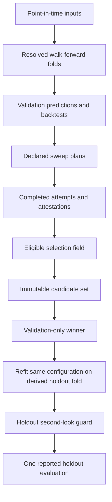
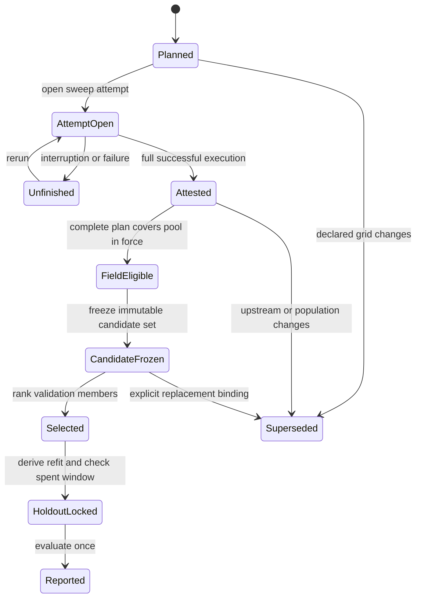

# Research Integrity and Evidence Boundaries

Research integrity here is a property of the **whole evidence path**, not merely of a model or metric. A defensible result must preserve decision-time information, use a declared temporal geometry, cover the population and sessions it claims to cover, select only on validation evidence, and evaluate the selected configuration on a separately governed holdout. The repository turns those methodological rules into registry identities, immutable sets, lineage, executable refusals, and tests.

This implements the workflow principle that exploration and confirmation are separate evidence regimes. The strategy is an executable decision process evaluated as if it were live, and search must remain countable: what was tried, what was eligible, what won, and what remained unseen must all be recoverable. See the broader [Research Runtime](../architecture/research-runtime.md), [Artifact Registry](../architecture/artifact-registry.md), and [Change and Run Case Studies](../workflows/change-and-run-case-studies.md) pages.

## The evidence lifecycle

*Validation evidence is completed and frozen before a selected configuration is re-keyed to the holdout geometry; the second-look guard protects the meaning of “unseen.”*

The important boundary is between **selection** and **estimation**:

- Validation folds are reusable development evidence. Feature choices, labels, hyperparameters, allocation, and risk overlays may be compared there, subject to the declared field.
- The candidate set freezes exactly which complete validation backtests were eligible. Selection ranks within that immutable set, deterministically by validation Sharpe with an identity tie-break.
- Holdout is not another tuning fold. The selected validation specification is refitted on one derived holdout fold, with only fold-dependent fields recomputed. Its result estimates the performance of the already selected process.
- Observing a holdout result spends the window. Deleting or retiring its row cannot restore ignorance.

## Temporal invariants

### Point-in-time inputs

Every feature available at decision time must depend only on information available by that time. This includes less obvious transformations: backward fill, centered windows, globally decoded or smoothed regime probabilities, and randomized time-series splits can all import future information. The leakage detector suite treats new executable occurrences as violations unless they are reviewed, justified, and allowlisted; known but unaudited occurrences remain backlog rather than approval. Development notebooks must apply the configured holdout boundary before their first selection statistic, and forward labels must be purged by the **label endpoint**, not merely by the signal timestamp.

A practical rule is: timestamping a value at *t* does not prove that it was knowable at *t*. The producer must preserve publication lags, entity boundaries, fitting windows, and any other information-time semantics.

### Walk-forward geometry is an identity

[`generate_cv_splits`](../../utils/cv_splits.py) extracts sorted unique timestamps, so panel row multiplicity does not alter fold cadence. It delegates calendar-aware rolling or expanding folds to `WalkForwardCV`, steps backward from the holdout boundary, returns folds oldest first, and asserts both chronological order and fold IDs. `CVSpec.resolve` records normalized boundaries and hashes the request plus the resolved folds; when an eligibility manifest is present, its keys and diagnostics also enter that identity.

The coding consequences are:

1. Generate folds from the panel's unique observation axis, not from raw row counts.
2. Respect the panel's cadence. A daily session buffer, an eight-hour panel, and a monthly panel cannot share arithmetic based on an assumed periods-per-day constant.
3. Treat fold IDs as semantic join keys. Reversing a list without renumbering it joins temporal artifacts to the wrong windows.
4. Use the canonical fold helpers rather than indexing a fold list when the intent is “earliest training start” or “most recent fold.”
5. Reject custom geometry that does not match fold-scoped temporal features. For holdout, require the chosen temporal fold to cover the requested training rows, every evaluation session, and the evaluation endpoint; if producer metadata says its fitting window reaches the holdout evaluation opening, refuse it as leakage.

### Buffers, embargoes, and the widest shared seal

The train/validation gap prevents a training label's future outcome from overlapping validation. `generate_cv_splits` interprets session-unit day buffers as counts of market sessions when a calendar exists; treating `21D` as 21 calendar days would leave only about 15 trading sessions. Validation signals whose outcome reaches the holdout are purged separately using the outcome horizon.

The derived holdout fold ends training one label buffer before the holdout opens. It counts backward on the panel's observed timestamps and measures the panel's own cadence; it does not subtract a generic calendar duration. For shared fold-scoped temporal artifacts, [`widest_label_buffer`](../../case_studies/research/holdout.py) chooses the largest buffer among the case study's primary and variant labels. A narrower shared fold is unsafe for a longer-horizon label because its features may have been fitted on observations beyond that label's allowed training boundary. Mixed session and calendar units are refused rather than compared as if they meant the same thing.

### Panel-aware decision cadence

The expected axis is the set of actual observations at which a model could decide, not a synthetic daily calendar. Coverage can be narrowed by a feature-panel decision axis, but never widened beyond non-null label timestamps. This distinction matters when an input feed is absent while prices and labels remain available: the model was blind, so the label file alone overstates feasible prediction coverage.

For intraday panels, the configured holdout end date includes the final observed session on that date. For all panels, buffer sizes are converted to observation counts using measured cadence, with a periods-per-year fallback for non-fixed durations such as months.

## Coverage is absolute, not peer-relative

Peer comparisons cannot detect a defect shared by every candidate. If a join drops the same week from all models, they still have equal coverage. The coverage gate therefore compares predictions or backtest inputs against the declaration: fold boundaries from configuration and sessions actually present with non-null labels.

A complete report requires all of the following:

- the observed fold IDs equal the declared fold IDs and timestamps stay within each fold;
- every expected session in every declared fold has at least one observation or prediction;
- the folds account for the complete declared validation window;
- where a fold subset is intentionally requested, it is a non-empty subset of declared folds;
- the checked label matches the artifact's own label when that evidence is available.

A missing file, missing time or fold column, empty frame, or unavailable declaration is an error, not a passing empty report. Coverage means observation availability, not trading activity: a flat target is still a covered decision.

**Fold coverage must also be comparable.** Candidate sets compare result protocols and reject undeclared differences. A comparison contract may explicitly name fields permitted to vary; everything else remains common protocol. Do not “fix” a coverage mismatch by intersecting candidates onto common support after the fact unless that support is itself the declared estimand—doing so changes the question and can hide a shared upstream loss.

## Declared populations, plans, and supersession

A registry row being complete and on the current identity schema does not mean its producer still publishes it. That governance statement belongs to an [`OfficialPopulation`](../../case_studies/research/population.py): a named, immutable snapshot of training, prediction, or backtest identities.

Population rules prevent common bypasses:

- Members are non-empty and unique, have the declared kind, and cannot be preview results. Canonical populations cannot admit backtests made from exploratory decision artifacts.
- A changed snapshot under an existing name must explicitly supersede the current generation. Older generations remain addressable evidence; they are not deleted.
- Resolution by name expects exactly one unsuperseded head. A fork is ambiguous and must be repaired, not resolved by recency.
- Retirement is computed **per population name and per member**. A new generation that changes three of ten identities retires those three, while unchanged identities remain live. An unrelated stale snapshot cannot restore identities their own publisher superseded.
- Positive membership is stronger than “not retired.” An experimental result that no official population ever published is not automatically eligible merely because nobody retired it.

Sweep plans are populations published before execution. They define the expected grid, making interruption visible: rows that happen to exist cannot prove the sweep finished. Each run opens a generation-specific attempt, and success publishes an attestation for that attempt. Readers require the latest attempt to be attested. Downstream generation identity includes upstream plan identities, so superseding a baseline plan invalidates attestations for allocation and risk grids derived from its old ranking.

*Plans, attempts, attestations, immutable selection, and explicit supersession make incomplete or changed research states visible instead of silently rankable.*

## Selection fields and candidate sets

The **selection field** answers “what may this holdout selection choose from?” It spans the `signal`, `allocation`, and `risk_overlay` validation stages for every declared label. Every label must reach a rankable signal baseline; absence means the run is unfinished, because freezing an immutable set before that point would permanently exclude the late label.

Where sweep plans exist, they control membership and must be complete, attested, and consistent with the prediction pool in force. A missing stage plan is not permission to rank historical rows. The field drops null-Sharpe rows and refuses incomplete planned members before coverage is assessed. The winning label is read from the winner's training lineage; downstream code must not substitute `labels.primary` when a variant label won.

A [`CandidateSet`](../../case_studies/research/comparison.py) then freezes complete canonical **validation** predictions or backtests under a comparison contract. Changed membership under the same name requires an explicit supersession edge, and resolving a name with multiple live heads refuses. `open_selection_field` prefers the recorded immutable set. Its live reconstruction path exists for registries with no recorded set, but reports that weaker source explicitly and applies the same field-building rule.

Do not bypass the field by querying a catalog and sorting whatever rows are present. That loses declared-label coverage, planned-grid membership, latest-attempt attestation, supersession, protocol compatibility, and the immutable record of what selection saw.

## Decisions and state transitions

Predictions are not yet trading decisions. `DecisionArtifact.publish` validates a decision frame, records exact prediction lineage and parameters, and content-addresses the normalized artifact. `target_positions` and `orders` must declare a [`StateTransitionPolicy`](../../case_studies/research/decisions.py) for both fold boundaries and temporal gaps, choosing `continue`, `reset`, or `liquidate`. This prevents portfolio state from leaking implicitly across disconnected validation windows.

Canonical promotion is stricter than exploratory publication: it requires current complete canonical prediction lineage, an importable source identity, exact declared prediction inputs, deterministic or seeded execution, and a clean-replay digest equal to the published artifact. Decision state is therefore explicit and auditable rather than hidden in notebook control flow.

## Holdout lock and second looks

[`build_holdout_cv`](../../case_studies/research/holdout.py) derives exactly one fold from the selected validation specification and the case study's configured holdout window. Training begins at the earliest validation training start unless fold-scoped features impose a later availability floor; it ends before the holdout by the widest buffer. [`build_holdout_training_spec`](../../case_studies/research/holdout.py) replaces the CV and dispatches to the model family to recompute eligibility, effective per-fold parameters, and other fold-derived fields. A family without that hook cannot run a holdout fit. This is a refit of the selected configuration, not an opportunity to alter its mechanics.

The **holdout lock** is operationally enforced by inspecting all prediction generations already registered against that window:

- an existing refit of a different configuration is a spent-window second look and is refused by default;
- proceeding deliberately requires naming exactly the superseded prediction hashes to retire, and the retired rows are returned for visible reporting;
- stale or absent override names refuse, so an old override cannot silently authorize the next generation;
- rows whose training specification records no CV split, or a non-holdout split, are not overridable because the registry cannot establish that they were valid holdout refits.

The override is disclosure and lifecycle control, **not restoration of out-of-sample status**. Once a result was observed, a later selection may have been influenced by it.

## Hashes are identities, not runtime proof

Configuration and training hashes are cache and lineage identities. `training_hash_from_spec` hashes a canonical projection of the resolved specification; it proves which computation was *declared* and lets equivalent requests collide on one identity. It does **not** prove that a runtime override actually reached the estimator, that the library honored it, or that a device/seed/model parameter took effect.

Consequently, do not use “the hash changed” as the sole runtime attestation. Validate the executed result against the resolved spec, record effective per-fold parameters where applicable, retain source/runtime provenance, and use clean replay or explicit execution attestations when the claim is about what actually ran. A hash can faithfully identify a wrong handoff.

## Safe-change checklist

Before changing evaluation, selection, or holdout code, verify:

1. Inputs remain point-in-time and label endpoints—not signal dates—define the leakage seal.
2. Fold generation still uses unique panel timestamps, declared cadence/calendar semantics, chronological IDs, and the correct label buffer unit.
3. Shared temporal artifacts use geometry safe for the widest label buffer and cover holdout training plus the full evaluation endpoint.
4. Coverage is checked against declarations and cannot turn missing evidence into a pass.
5. Every declared label and planned stage is complete; the latest generation-specific attempt is attested.
6. The selection field contains only complete, rankable, protocol-compatible validation results from published populations.
7. Population and candidate-set changes use explicit supersession rather than deletion, recency, or silent filtering.
8. The winner's own label and immutable candidate set flow into the holdout refit.
9. Holdout-derived fields are re-keyed to one holdout fold, and no selection decision reads holdout results.
10. A spent window is refused unless the exact prior generation is deliberately named and disclosed.
11. Decision artifacts declare fold/gap state transitions, and canonical promotion carries deterministic replay evidence.
12. Runtime behavior is independently attested; configuration hashes are not treated as proof of override delivery.

## Focused regression gates

The most relevant executable specifications are:

- [`tests/test_leakage_detectors.py`](../../tests/test_leakage_detectors.py): default-deny AST ratchets for global decoding, random temporal splits, and future-aware fills.
- [`tests/test_holdout_boundary.py`](../../tests/test_holdout_boundary.py): configured holdout scoping before development statistics and endpoint-based forward-label purging.
- [`tests/test_coverage_gate.py`](../../tests/test_coverage_gate.py): absolute session/fold coverage and failures when coverage cannot be evaluated.
- [`tests/test_population_supersedes.py`](../../tests/test_population_supersedes.py): current-generation resolution and explicit population lineage.
- [`tests/test_holdout_second_look_refusal.py`](../../tests/test_holdout_second_look_refusal.py): default refusal, exact per-generation override, and non-overridable unattributable/non-out-of-sample rows.
