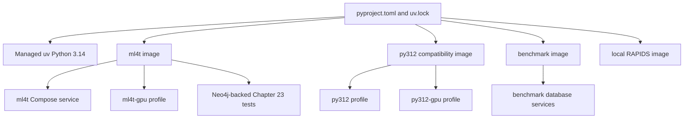
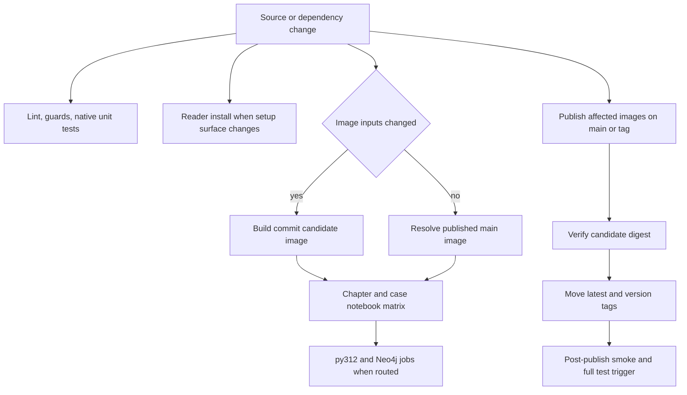

# Environments, Dependencies, and CI Operations

The repository deliberately has several execution environments rather than one universal image. The default local path and main image target Python 3.14; incompatible or specialized workloads are routed to Python 3.12, database, RAPIDS, GPU, or Neo4j-backed environments. A dependency or runtime change is therefore complete only when the manifest, lock, images, Compose services, tests, and reader-facing documentation still describe the same system.

For initial commands, see the [Quickstart](../quickstart.md). For path and mount behavior, see [Data and Path Runtime](../architecture/data-and-path-runtime.md); for notebook source/output constraints, see [Edit Notebooks](../workflows/edit-notebooks.md); and for harness internals, see [Test System](../testing/test-system.md).

## Runtime map

| Runtime | Intended use | Platform and operational notes |
|---|---|---|
| Local managed `uv` | Normal local development and notebook execution | [`pyproject.toml`](../../pyproject.toml) requires Python `>=3.14,<3.15` and sets `python-preference = "only-managed"`. `uv sync` therefore installs a managed CPython rather than inheriting a compatible distro interpreter whose headers or `sitecustomize.py` may differ. Linux needs a compiler and Python headers; Apple Silicon needs `libomp`. Native Windows is exercised in CI. Intel macOS is intentionally Docker-only because no compatible `torch` distribution exists. |
| `ml4t` | Default reader image for all chapters and case studies | [`envs/ml4t/Dockerfile`](../../envs/ml4t/Dockerfile) builds amd64 and arm64 variants around a managed Python 3.14 environment at `/opt/ml4t`. amd64 installs CUDA 12.8 PyTorch wheels, builds the lock-selected LightGBM with CUDA, and includes Chrome for Kaleido PNG output; arm64 uses CPU PyTorch and wheel LightGBM. |
| `ml4t-gpu` | Main image with NVIDIA passthrough | The [`docker-compose.yml`](../../docker-compose.yml) GPU profile uses the same image and mounts as `ml4t`, exposes Jupyter on `127.0.0.1:8889`, and reserves all NVIDIA devices. It is not a separate dependency set. |
| `py312` / `py312-gpu` | Compatibility notebooks that cannot use the Python 3.14 stack | amd64-only [`envs/py312/Dockerfile`](../../envs/py312/Dockerfile) carries `gensim`, `signatory`, and `esig`, plus notebooks affected by the Python 3.14 Torch/CUDA path. `tfcausalimpact==0.0.18` needs NumPy 1.x and pandas at most 2.2, so it lives in a second interpreter at `/opt/bsts`; the normal `/opt/ml4t` interpreter keeps the NumPy 2 signature stack. `py312-gpu` attaches one NVIDIA device to the same image. Apple Silicon can use amd64 emulation or committed outputs, not a native image. |
| `benchmark` / `benchmark-full` | Chapter 2 storage and database comparisons | The published Python 3.14 benchmark image is amd64 and arm64 and contains file-format and database clients. Compose can start TimescaleDB, PostgreSQL, ClickHouse, QuestDB, and InfluxDB alongside it. ArcticDB has no Linux arm64 wheel and is reserved for the locally built amd64 `benchmark-full` profile. Personal kdb+/PyKX files are runtime read-only mounts and are never baked into a published image. |
| `rapids` | One Chapter 12 GBM comparison | [`envs/rapids/Dockerfile`](../../envs/rapids/Dockerfile) is a locally built, amd64-only Python 3.12 image requiring NVIDIA Container Toolkit. It preserves the RAPIDS base image's compiled NumPy/pandas/Arrow/Polars stack, takes SciPy and non-base packages from the root lock, and builds the lock-selected LightGBM with CUDA. It is not published or built by the image workflow. |
| Neo4j service | Chapter 23 graph-producing and graph-consuming notebooks | The `kg` Compose profile runs pinned Neo4j Community with persistent data/log volumes and a health check. The CI Neo4j job starts the same version, publishes Bolt on localhost, and runs producers before consumers because several notebooks share graph state. |

The main, GPU, and compatibility services bind the repository at `/app` and reader data at `/data`. `ML4T_PATH=/app` and `ML4T_DATA_PATH=/data` make those mounts the runtime roots. The data mount must remain explicitly writable; the Hugging Face cache is also writable so unpinned first loads can populate it. Create the host cache directory before Compose to avoid Docker creating it as root. Jupyter ports are loopback-only because the images disable the Jupyter token; origin and XSRF protection remain enabled.



*The dependency sources fan out to purpose-specific images; Compose profiles then add hardware or service dependencies without pretending they are one portable runtime.*

## Local installation and diagnostics

The supported local sequence is conceptually:

```bash
uv sync
cp .env.example .env
uv run python scripts/verify_installation.py
```

[`scripts/verify_installation.py`](../../scripts/verify_installation.py) is more than a package list. It imports core libraries and the concrete `ml4t.data`, `ml4t.diagnostic`, `ml4t.engineer`, `ml4t.models`, `ml4t.backtest`, and `ml4t.live` subpackages; checks repository packages and representative exports; and validates the repo root on `sys.path`, the repository `sitecustomize.py`, chapter-helper imports, an existing `ML4T_DATA_PATH`, Matplotlib configuration, the Plotly template/renderer, and CUDA detection. Missing GPU support is a skip; a failure in a required category exits nonzero. Docker-profile extras are reported but do not fail the standard installation.

Use that script after a local sync, after building or pulling the main image, and when an import works at top level but fails in a concrete ML4T subpackage. Useful container diagnostics are:

```bash
docker compose run --rm ml4t python scripts/verify_installation.py
docker compose run --rm ml4t ml4t-test-imports
docker compose run --rm ml4t ml4t-status
docker compose --profile py312 run --rm py312 python envs/test_all_imports.py --image py312
docker compose --profile benchmark run --rm benchmark python envs/test_all_imports.py --image benchmark
```

Interpret common failures by boundary:

- A wrong `sitecustomize.py`, moving `ML4T_DATA_PATH` when the working directory changes, or missing chapter helper imports points to interpreter/startup packaging rather than the notebook.
- `Read-only file system` under `/data`, or a download absent from the host, points to Compose mount/environment wiring. [`tests/test_compose_mounts.py`](../../tests/test_compose_mounts.py) statically pins the contract; the container smoke proves it end to end.
- A required import failure should be fixed in the owning dependency/image. Do not relabel it optional merely to make verification green.
- A py312 BSTS failure must be reproduced with `/opt/bsts/bin/python`; using the default py312 interpreter tests a different and intentionally incompatible NumPy stack.
- A graph notebook can fail because its producer did not run. Reproduce the CI pipeline order, not just the consumer in an empty Neo4j database.

## Dependency invariants and intentional conflicts

The root manifest expresses compatibility policy; [`uv.lock`](../../uv.lock) expresses the exact resolved environment. Container builds export fully pinned constraints from that lock rather than freely resolving lower bounds. [`tests/test_env_matches_lock.py`](../../tests/test_env_matches_lock.py) proves that lower *and* higher installed versions are drift, while permitting packages absent from a particular image and explicit special-build carve-outs. Notebook and Neo4j jobs also run the environment-vs-lock checker inside the selected image. When `pyproject.toml` changes, regenerate and commit `uv.lock`; when only `uv.lock` changes, treat that as an environment change affecting every notebook and image.

Important constraints documented in [`pyproject.toml`](../../pyproject.toml) include:

- `scipy>=1.12,<1.18` protects PyPortfolioOpt's use of a removed private hierarchy constant.
- `transformers>=4.40,<5` avoids an untested major-version transition.
- `protobuf>=5.0` is a `uv` override for Python 3.14 because protobuf 4.x has a C-extension metaclass failure. Image comparison checks the override range rather than blindly demanding the lock's exact protobuf version.
- `litellm>=1.83.0` establishes a security floor. The usable CrewAI 0.x line and the Chapter 22 Chroma stack have conflicting upper bounds, so changing either requires resolving the whole agent/RAG set rather than bumping one package in isolation.
- `ib_async`, not unmaintained `ib_insync`, is the live-trading extra. Both install `eventkit`; the latter's import-time event-loop behavior fails on Python 3.14.
- `kaleido>=1.3` needs Chrome. The main amd64 image installs Chrome; arm64 can fall back to an interactive renderer. The py312 and benchmark manifests intentionally cap Kaleido below 1 because those images do not carry Chrome.
- `torchdiffeq` is used instead of `torchode`, whose `torchtyping` dependency conflicts with the current Torch line.
- `gensim`, `signatory`, `esig`, and `tfcausalimpact` stay out of the main Python 3.14 environment and belong to py312. RAPIDS' compiled base constraints are likewise not replaceable wholesale with root-lock versions.

Ruff is an exact multi-surface pin: `ruff==0.15.14` in the dev extra, `v0.15.14` in [`.pre-commit-config.yaml`](../../.pre-commit-config.yaml), and `uvx ruff@0.15.14` in CI. [`tests/test_toolchain_pins.py`](../../tests/test_toolchain_pins.py) holds all three plus the lock together. Ruff's target remains `py312` even though the main runtime is 3.14, preventing format rewrites that older reader tooling cannot yet consume. A formatter-only mismatch can stale a paired `.ipynb` because Jupytext embeds the formatted `.py` source.

The pre-commit surface also checks syntax, notebook-pair loadability, Plotly output size, notebook execution provenance, verified notebook hashes, and macOS-sensitive OpenMP import order. Run it before pushing:

```bash
pre-commit run --all-files
```

## CI surfaces and triggers

| Workflow | Trigger and scope | What it validates |
|---|---|---|
| [`reader-install.yml`](../../.github/workflows/reader-install.yml) | Weekly Monday 05:00 UTC, manual, and PR changes to installation/dependency/data/setup surfaces | Walks documented first install on clean Linux x86_64, Apple Silicon macOS, and native Windows: install `uv`, `uv sync`, verify stable data-root/startup-hook behavior, copy `.env`, run installation verification, download free data, execute the first notebook, and fit LightGBM. A separate Intel macOS job asserts that sync still fails specifically because `torch` has no distribution, keeping Docker-only documentation honest. |
| [`container-smoke.yml`](../../.github/workflows/container-smoke.yml) | Weekly Monday 06:00 UTC, manual, and PR changes to Compose or `envs/**` | Runs the reader's actual `docker compose run` download into a workspace-backed data mount, rejects the read-only filesystem signature, and proves the expected Parquet file appears on the host. Weekly failures open or update an issue. |
| [`test.yml`](../../.github/workflows/test.yml) | PRs, every push to `main`, weekly Monday 06:00 UTC, completion of Docker Publish, and manual dispatch | PRs use path-filtered chapter/case matrices; `main`, schedule, post-publish, or `run_all` executes the full shipped matrix. Always-on lint, notebook guards, and fast native unit tests precede Docker notebook tests. Main chapter/case jobs use the image declared by the commit—building a candidate when image inputs change—and check it against the lock. Dedicated jobs route compatibility notebooks to py312 and graph notebooks to a healthy Neo4j service. The benchmark job is currently disabled because QuestDB health is unreliable in CI. Fork PRs without the private test-data deploy key visibly skip data-dependent notebook execution rather than claiming it ran. |
| [`full-test.yml`](../../.github/workflows/full-test.yml) | Manual release gate, selectable as all, chapters-only, or case-studies-only | Runs all chapter notebooks and a nine-case-study matrix in the published main image; the all scope also runs the py312 set. It uses the private CI fixture checkout and seeded intermediates. This is the explicit broad pre-release run, not the incremental PR workflow. |
| [`weekly-external.yml`](../../.github/workflows/weekly-external.yml) | Monday full run; Wednesday/Friday Hugging Face cache touches; manual full/touch mode | Enables `ML4T_TEST_TIER=weekly`, runs weekly-marked notebooks with only free-provider credentials, prefetches pinned model revisions, and runs tiny live pulls from free external data sources. JUnit-driven automation opens, reopens, and closes per-notebook/source issues. Skips are not passes. Midweek jobs restore the stable model cache so GitHub's seven-day inactivity eviction does not discard it. |
| [`docker-publish.yml`](../../.github/workflows/docker-publish.yml) | `v3.*` tags, relevant pushes to `main` selected inside the workflow, and manual image choice | Publishes main and benchmark as native amd64/arm64 manifests and py312 as amd64. Root manifest or lock changes stale all three; image-specific manifests/Dockerfiles select individual rebuilds. Main images are pushed first by digest, verified on each architecture with the same reader installation script, and only then merged into movable tags. Post-merge import, reader-gate, and computation smoke tests verify manifest resolution. RAPIDS is outside this publishing flow. |

A useful model for CI is:



*Dependency-affecting commits are tested in a candidate image before notebook results are trusted; release tags move only after candidate verification.*

## Safe change checklist

When changing dependencies, Python/runtime assumptions, image build steps, mounts, or CI routing:

1. Update `pyproject.toml` comments alongside the constraint so the reason and removal condition remain discoverable; regenerate `uv.lock` with `uv lock` or the intended targeted upgrade.
2. Keep image constraint generation aligned with the lock. If a package must be off-lock, make the exception narrow, documented, and represented in the environment comparison logic/tests.
3. Update every affected specialized manifest or Dockerfile. A root dependency may affect main, py312, benchmark, and RAPIDS differently; do not copy a version into the RAPIDS compiled core without checking its base constraints.
4. Keep the Ruff dev, pre-commit, CI, and lock pins identical. Run the focused toolchain and lock tests as well as pre-commit.
5. Preserve Compose's explicit `/data:rw`, `ML4T_DATA_PATH=/data`, host-UID execution, loopback Jupyter binding, and writable Hugging Face cache. Run both `tests/test_compose_mounts.py` and the container smoke for mount changes.
6. Update the path filters in `test.yml` and `docker-publish.yml` when an image starts reading a new build input. Otherwise a commit can change the declared image without building or testing that image.
7. Update `envs/README.md`, installation/README guidance, and relevant commands whenever support or routing changes. Documentation is executable policy: reader-install and Compose smoke intentionally follow the documented route.
8. Run the narrow specialized path—`py312`, Neo4j producer/consumer order, benchmark services, or RAPIDS GPU—as applicable. For a release, manually run the full suite; use weekly external results to distinguish repository regressions from provider drift.
