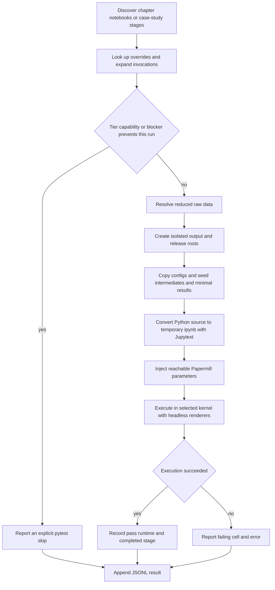

# Test System and Validation Strategy

The test system has two complementary jobs. Conventional pytest tests pin small, important contracts such as artifact identity, registry behavior, loaders, fixture generation, and notebook-pair hygiene. Notebook tests then execute reader-facing `.py` notebooks through Jupytext and Papermill against a reduced but structurally representative data and artifact set. The latter are integration tests, not a replacement for focused tests: they are slower, environment-sensitive, and deliberately avoid rebuilding every upstream stage.

For artifact ownership and operational CI details, also see [Artifact Registry](../architecture/artifact-registry.md) and [Environments and CI](../operations/environments-and-ci.md). [Research Integrity](../concepts/research-integrity.md) explains why temporal availability and honest failure semantics are research contracts rather than cosmetic checks. For author workflows, see [Change and Run Case Studies](../workflows/change-and-run-case-studies.md) and [Edit Notebooks](../workflows/edit-notebooks.md).

## Validation layers

| Layer | What it establishes | Representative entry points |
|---|---|---|
| Static and reader-facing guards | Formatting, import/provenance rules, paired `.py`/`.ipynb` consistency, safe paths, notebook metadata hygiene, and ratcheted checks for result numerals in Jupytext markdown | CI `lint` and `guards`; `.github/scripts/check_prose_numerals.py`; focused `tests/test_notebook_*` files |
| Unit tests | Pure transformations, loaders, download dispatch, path routing, environment helpers, fixture builders, and failure cases | `pytest tests/test_<area>.py` |
| Contract tests | Registry identity, immutable artifacts, supersession, research planning, retry behavior, and workspace-versus-release boundaries | [`test_research_contract_execution.py`](../../tests/test_research_contract_execution.py) and the focused registry/identity suites |
| Fixture integrity | Reduced data matches builder declarations; every fixture file has an owner; registries describe artifacts actually shipped | fixture manifest, producer, registry, and sampling tests |
| Notebook execution | The notebook source converts to an executable notebook and completes through the production code path with reduced parameters | [`test_chapter_notebooks.py`](../../tests/test_chapter_notebooks.py), [`test_case_studies.py`](../../tests/test_case_studies.py), and [`pm_helpers.py`](../../tests/pm_helpers.py) |
| Environment integration | The notebook works in the image, interpreter, service, and dependency combination assigned to it | chapter matrix, Python 3.12, Neo4j, and image-lock checks in [`test.yml`](../../.github/workflows/test.yml) |
| Release sweep | All selected chapters and all case-study matrix lanes are run manually, with an aggregate failing summary | [`full-test.yml`](../../.github/workflows/full-test.yml) |

The fast `test-unit` CI job installs a deliberately bounded dependency surface and then runs named high-value suites plus an “every other test file” sweep. The latter excludes only the explicitly justified entries in `.github/ci/unit-test-quarantine.txt`; this makes a newly added test run by default instead of depending on somebody remembering to add its filename to the workflow. Data-backed fixture checks live in `test-unit-data`, because a test that skips for missing fixture data is not evidence that the property passed.

## Post-baseline regression gates

These gates extend the existing layers; they do not move ownership out of production code or turn notebook execution into a substitute for a focused assertion. All three focused pytest files are ordinary, data-free tests covered by the `test-unit` subtraction sweep because they are not quarantined. The related notebook lane remains responsible for end-to-end imports, parameters, fixture wiring, and execution in the reader image.

### Chapter 13 sequence alignment

[`test_chapter_sequence_windows.py`](../../tests/test_chapter_sequence_windows.py) imports the canonical builders from [`dl_sequences.py`](../../13_dl_time_series/dl_sequences.py) and uses row-identifying synthetic features to prove that an ordinary sequence and its patched reshape end on the same row as their forward-return target. For a lookback of `L`, the first valid window is rows `0..L-1`, dated at row `L-1`; each symbol therefore contributes `n - (L - 1)` samples. A symbol with exactly `L` rows must contribute one sample rather than being discarded. The suite also proves that plain and patched builders cover identical rows, targets, and flattened feature values.

This is specifically the contract for feature design matrices consumed by the RNN, Transformer, and CNN-style builders. It does not impose that alignment on the foundation-model context builder described by the test: a context that is extrapolated forward from the decision date intentionally stops before the forecast path begins. The production owner is `create_sequences_multi_asset` and `create_patched_sequences_multi_asset`; chapter notebook execution owns only their integration with a complete notebook.

### Live ETF macro availability

[`test_the_live_etf_regime_features_respect_the_macro_availability_lag.py`](../../tests/test_the_live_etf_regime_features_respect_the_macro_availability_lag.py) states the contract in information-availability terms. At several mature probe sessions, it computes `regime`, `yield_curve_slope`, and `yield_curve_zscore` once from the full calendar-day curve and once from a curve truncated to values visible by the previous day. The results must match and must be non-null. This catches a same-session as-of join that would let deployment consume a Treasury observation unavailable at that close.

The implementation owner is `_add_regime_indicators` in [`_etfs_features.py`](../../25_live_trading/_etfs_features.py). It first re-stamps macro observations by `MACRO_LAG_DAYS`, then backward-as-of joins them to the distinct trading-session calendar, and only then computes the configured rolling z-score. The module reads the lag, threshold, and z-score window from the ETF case-study configuration rather than maintaining live-only copies; the focused suite pins the lag and threshold relationship. The Chapter 25 notebook test still owns data loading, model selection, and deployment-loop integration.

### Vectorized backtest insolvency

The vectorized path computes a period’s gross portfolio return as the sum of `weight * y_true`; it has no broker, margin updates, liquidation fill, or intraperiod position state. [`test_backtest_runner_helpers.py`](../../tests/test_backtest_runner_helpers.py) therefore distinguishes two cases around the account boundary:

- a fully invested long book using the panel’s bounded worst forward return is allowed to run, even though its loss is large, because the gross period return remains above `-1.0`;
- a short exposed to a sufficiently large positive asset return is refused when the aggregate gross period return falls below `-1.0`, because silently clipping it would invent a liquidation price and accepting it would register an unbrokered loss greater than the account.

The guard belongs in `_run_vectorized` in [`backtest_runner.py`](../../case_studies/utils/backtest_runner.py), after canonical-window slicing and before portfolio risk overlays and metric computation. Its diagnostic names the worst contributing positions and directs the caller to bound the short leg or use the engine path. This boundary is deliberately narrower than the shared ruin semantics: broker-backed or otherwise valid return paths may be stopped at zero equity for reporting, while the vectorized path must reject a gross return that its stateless approximation cannot honestly produce.

### Static notebook-prose ratchet

The always-on `guards` job runs [`check_prose_numerals.py`](../../.github/scripts/check_prose_numerals.py) twice: first with `--selftest`, then over the repository. The scanner considers only Jupytext `.py` sources that have a committed sibling `.ipynb` (unless a file is explicitly passed), and only untagged percent-format markdown cells. A markdown cell tagged `results` is exempt; the self-test checks both the tagged exemption and the same sentence in an untagged cell, in addition to positive and negative numeral cases.

This is a deliberately narrow lexical guard, not semantic prose analysis. It detects decimals and percentages after masking code, math, links, URLs, headings, and recognized cross-references; it does not decide whether number-free narration such as “the ensemble does better” has gone stale. [`prose-numerals.txt`](../../.github/ci/prose-numerals.txt) records existing `(path, numeral, count)` sites. A new or increased site fails, and a whole-repository run also fails when a listed count has fallen without the ratchet being reduced. Existing debt can therefore only stay level or shrink; touching and re-executing a listed notebook is the point to move computed values into figures, tables, or `results` cells and lower or remove its entry.

## Notebook execution flow



*Notebook discovery, fixture preparation, isolated Papermill execution, and incremental result reporting.*

### Discovery and parametrization

Chapter discovery scans top-level `NN_*` chapter directories, excludes helpers, tests, archives, and drafts, and selects notebook-like `.py` files. The chapter test also adds `data/**/dataset_card.py`. Case-study discovery scans each shipped case-study directory for numbered stages, sorts lettered producers before a bare aggregate of the same stage number, and expands an override entry’s `invocations` into independently reported pytest cases. This expansion matters when one notebook must run for several labels: each invocation receives its own test identity and result, while collection remains stage-major so all producer invocations precede the next stage.

[`notebook_catalog.py`](../../tests/notebook_catalog.py) is a separate operational inventory. It combines the same chapter discovery with numbered case-study stages, classifies them into heuristic resource lanes, and stores inventory and run status in a local SQLite catalog. [`notebook_worker.py`](../../tests/notebook_worker.py) consumes one catalog assignment in either reduced mode, through `run_notebook`, or full mode, without injected reductions. These files support managed notebook campaigns; the ordinary CI path is the two parametrized pytest modules above.

### Same code path, smaller problem

Production defaults stay in the notebook’s tagged parameters cell. [`overrides.yaml`](../../tests/overrides.yaml) changes quantities such as symbols, folds, epochs, rows, or trial counts. `run_notebook` explicitly removes legacy `TEST` and `QUICK_TEST` environment variables before launching the kernel. The tested computation therefore follows the notebook’s normal branches; only its scale and, for migrated research notebooks, its declared execution tier/workspace differ.

Papermill accepts ineffective parameters surprisingly easily. A name can be invisible to Papermill’s own parser, never read below the injection point, or unconditionally rebound before its first read. `unusable_parameters` checks all three cases. The corpus tests require every override key to name a real notebook and every declared parameter to reach its notebook on both preview and canonical fixture-generation paths. They also reject malformed multi-invocation shapes and unknown reduction vocabulary. Fix an unreachable override by making the notebook consume it or deleting it—not by adding an exception.

For research notebooks, preview routing injects `EXECUTION_TIER="preview"`, an isolated `WORKSPACE`, and a structured `PREVIEW_REDUCTIONS` mapping where supported. A reader-only downstream stage may set `research_preview: false`: it still receives the isolated workspace, but reads the seeded canonical fixture rows because no producer has populated its fresh preview registry. Canonical fixture generation strips preview-only parameters and parameters the notebook’s own canonical guard refuses.

### Execution and cleanup

`run_notebook` converts the `.py` source to a temporary `.ipynb`; it never overwrites the committed pair. Papermill executes that temporary input into a transient `_executed_*.ipynb`, saves after each cell, writes a per-process progress log under `/tmp`, reports the failing cell for `PapermillExecutionError`, and removes temporary notebooks and kernelspecs afterward. The kernel receives headless Matplotlib and Plotly settings, a repository-plus-notebook `PYTHONPATH`, thread-pool caps, and `ML4T_ENTRY_POINT`. An override may route one notebook to a separate interpreter and launcher through a temporary kernelspec.

Pytest’s report hook appends one JSON object per completed call—or setup skip—to `ML4T_RESULTS_FILE`, defaulting to `/tmp/ml4t-test-results.jsonl`. Flushing each record means partial results survive a killed process. The manual full workflow uploads the chapter result file and its final summary fails if any required lane failed.

## Data, intermediates, and isolation

### Raw reduced data is not an intermediate

`ML4T_DATA_PATH` points loaders at raw or source-shaped data. In CI this is `test-data/data` from the private `ml4t/third-edition-test-data` checkout at the deliberately moved `ci` tag. The fixture keeps schemas and useful time ranges while reducing entity counts and expensive dimensions. A missing populated fixture causes notebook tests to skip through `populated_data_dir`; CI jobs that promise data first assert that both raw data and intermediates exist so an empty checkout cannot turn into a green all-skip run.

Intermediates live beside the raw data under `test-data/intermediates`. They include case-study features, labels, evaluation data, registry rows, predictions, backtests, and selected chapter outputs. They let a downstream notebook run independently rather than paying for every producer in every test. At session setup, the harness **replaces** seeded subdirectories instead of filling missing files, preventing leftovers from an earlier run from contaminating registry identity or resolution. It then reconciles legacy prediction column names and invokes `tests/fixtures/seed_results.py` only to fill narrowly defined gaps.

The distinction guides debugging:

- a loader or source-schema failure points first to `ML4T_DATA_PATH` and the raw fixture producer;
- a missing feature, label, prediction, or registry row points first to intermediates, their sampler/generator, and registry consistency;
- a focused preview consumer may legitimately require an earlier stage in the same workspace because preview registries are intentionally not pre-seeded.

### Output and release-root isolation

`seeded_output_dir` sets `ML4T_OUTPUT_DIR` to a session/worker-specific directory, copies and reduces case-study configs, patches test model presets, and seeds intermediates there. With xdist, each worker gets its own subtree. Autouse cleanup restores process-global output routing and workspace caches after every test, preventing one test’s temporary study activation from redirecting later tests.

Isolation has a second boundary: canonical reads. A maintainer checkout can contain `case_studies/<id>/run_log` symlinks to published artifacts. The harness therefore builds a checkout-shaped `.release` tree containing source configs and tracked files but no production `run_log`, then sets `ML4T_RELEASE_ROOT` to it. A canonical-tier notebook under test can read the seeded fixture and write to its workspace without overlaying or mutating the maintainer’s published registry.

## Fixture and registry invariants

The fixture is treated as a generated product with enforceable ownership, not a bag of convenient files.

1. `tests/create_test_data.py` declares production-derived datasets, the paths each owns, and measurable reduction budgets. `manifest.json` must agree with those declarations in both directions and with the files and entity counts actually on disk.
2. `tests/generate_test_microstructure.py` is the synthetic raw-data producer. Its generated paths must not overlap paths owned by a production-derived dataset. Every production-sourced exclusion must have exactly one builder.
3. Every fixture data file must be covered by one of those producers, except the explicit shrinking `UNPRODUCED` ratchet. An exempt file that gains a producer or disappears must leave the ratchet.
4. Fixture registries must describe the fixture’s bytes. Training rows whose pinned feature or label digests are absent are stale and are pruned together with dependent prediction, metric, population, and backtest rows. Deleting only the training parent is insufficient because SQLite foreign keys are not automatically enforced for every connection.
5. Registry sampling keeps model-side rows, representative backtests, all holdouts, and complete downstream grids for retained predictions. Registry rows backed by prediction artifacts already in the fixture are captured before a resample and restored afterward, so shipped artifacts remain addressable. Pinned notebook prediction configurations bring both registry lineage and reduced parquet artifacts.
6. Generators and samplers reject an output root inside `case_studies` or one that resolves through symlinks onto a production registry.

See [Artifact Registry](../architecture/artifact-registry.md) for the production model; the tests here enforce that the reduced copy remains a coherent instance of it.

## Skips, blockers, and prerequisites

A skip is expected to remain auditable:

- `tier` routes per-commit, weekly, and on-demand notebooks; a tier mismatch is an explicit skip.
- `requires_env`, `requires_import`, and `gpu` describe runtime capabilities. GPU checks distinguish a visible Torch CUDA device from a CUDA-enabled LightGBM build.
- `skip: true` should carry a `skip_blocker`. Decidable blockers inspect the actual CI fixture path or seeded registry. When the missing file, population, candidate set, or selection appears, `honoured_skip_reason` stops honoring the skip and the blocker tests require its declaration to be retired.
- Undecidable external and fixture-shortfall blockers have stricter metadata, including tier or recent verification expectations.
- `requires_stage` is for data created only during this test session. A focused or sharded run skips the consumer and names the missing prerequisite; an in-order case-study run satisfies it.
- Case-study rebuild deferrals are checked against registry state and expire when their required input appears.

A skip caused by a fork lacking `TEST_DATA_DEPLOY_KEY` is operationally different. Data-dependent CI jobs gate their checkout and execution steps rather than omitting the job, so required check contexts can complete. Their notice explicitly says no notebook was executed; the same notebooks run after merge in a context that can read the private fixture.

## Environment assignment and CI gates

The main [`test.yml`](../../.github/workflows/test.yml) is incremental on pull requests and full-matrix on pushes to `main`, scheduled runs, post-image-publish runs, or manual `run_all`. Path filters construct chapter and case-study matrices. Changes to shared utilities, research code/config, data code, the lockfile, or notebook harness fan out broadly; a chapter or case-study-local change selects its lane. The matrix enrolls only chapter directories and numbered case-study stages present in the checkout.

Environment assignment has two parts:

- `overrides.yaml` records notebook capability metadata such as `docker_env`, `kernel_python`, `requires_import`, and `gpu`; collection applies tier/GPU/long-running markers and runtime checks capabilities.
- CI owns concrete lanes. Normal chapter and case-study tests run in the resolved `ml4t` image. An explicit Python 3.12 list runs in `ml4t-py312`; Neo4j notebooks run in dependency order against a service container; benchmark routing is currently disabled in the dynamic matrix; GPU-only coverage belongs to its dedicated tier rather than the CPU chapter matrix.

When `uv.lock`, `pyproject.toml`, or `envs/ml4t/Dockerfile` changes, CI builds and selects a candidate image from the same commit. Notebook jobs check installed distributions against `uv.lock` before execution. This prevents a dependency change from being “tested” in the older published image it replaces. See [Environments and CI](../operations/environments-and-ci.md) for image operations.

The manual [`full-test.yml`](../../.github/workflows/full-test.yml) provides `all`, `chapters-only`, and `case-studies-only` scopes. It uses per-notebook cell budgets from `overrides.yaml` and a job-level timeout rather than imposing a blanket pytest timeout shorter than legitimate notebooks. It is the pre-release breadth gate; it does not replace the always-on lint, guard, unit, data-integrity, or specialized-service checks.

## Change-to-test matrix

Use the narrow tests for fast diagnosis, then the affected integration lane. CI’s subtraction sweep and path matrix provide the broader backstop.

| Change | Minimum focused validation | Integration/breadth validation |
|---|---|---|
| Shared utility under `utils/` or `case_studies/utils/` | Its focused unit tests plus relevant contract tests; for research/registry utilities include `tests/test_research_contract_execution.py` and identity-specific suites | Run one representative consuming stage, then affected case-study and chapter lanes; CI treats these paths as shared and fans out the notebook matrix |
| Registry schema, hashes, identity, supersession, or workspace routing | Registry schema/identity/lineage tests, artifact digest/sidecar tests, and `tests/test_research_contract_execution.py` | Run producer and consumer stages against an isolated seeded output; regenerate/reconcile fixture registries if stored rows or artifacts changed |
| One case-study stage | The stage helper’s unit tests, override reachability checks, and any declared registry-write contract | `pytest tests/test_case_studies.py -v -k "<case-study> and <stage>"`; include prerequisite stages or run the whole case study when `requires_stage` applies |
| Chapter 13 sequence-window construction | `pytest tests/test_chapter_sequence_windows.py -q`; preserve target-row inclusion, earliest full windows, exact-length symbols, and plain/patched equivalence | Run the affected Chapter 13 notebook in the `ch13` lane; do not apply the feature-window rule to forecast contexts that intentionally end before their forecast path |
| Live ETF regime or macro alignment | `pytest tests/test_the_live_etf_regime_features_respect_the_macro_availability_lag.py -q`; test full versus availability-truncated macro inputs and configuration ownership | Run `25_live_trading/02_etfs_deployment_loop` in the Chapter 25 lane with its reduced-data override; use a live-data smoke separately when changing the upstream FRED acquisition path |
| Vectorized return aggregation, shorting, or risk ordering | `pytest tests/test_backtest_runner_helpers.py -q`; retain the allowed bounded-long and refused unbrokered-short boundary | Run a representative vectorized case-study stage; also run an engine-mode long/short consumer when changing shared ruin or metric semantics |
| Notebook markdown containing computed numerals | `python .github/scripts/check_prose_numerals.py --selftest`, then run it on the edited paired `.py`; move values to a figure, table, or `results` cell rather than expanding the ratchet | Run the full repository checker and the normal pair/provenance guards; re-execute the notebook if changing a code cell or committed render |
| Teaching notebook | `tests/test_pm_helpers.py`, override-schema checks, import/provenance and notebook hygiene tests | `pytest tests/test_chapter_notebooks.py -v -k "<notebook>"` in its assigned image/service lane |
| Data loader or download path | Focused loader/download tests, path/data-root contracts, and synthetic edge cases | Fixture manifest/producer tests and the dependent dataset-card/chapter/case-study notebooks; regenerate reduced raw data when schema or owned paths change |
| Dockerfile, Compose mounts/ports, or dependency lock | `tests/test_compose_mounts.py`, `tests/test_compose_ports.py`, environment-lock and image-trigger tests, plus docs/compose consistency where applicable | Build the candidate image, verify it matches `uv.lock`, then run at least one notebook in each affected environment/service combination |
| Paired notebook metadata or Jupytext header | `tests/test_notebook_pair_metadata_filter.py`, pair-sync/prose/import/output hygiene tests, and provenance guards | Re-execute the exact notebook from its `.py`, sync deliberately, and confirm the committed pair remains openable and clean |

Useful focused commands are:

```bash
uv run pytest tests/test_pm_helpers.py -v --tb=short
uv run pytest tests/test_research_contract_execution.py -q --tb=short
uv run pytest tests/test_chapter_sequence_windows.py -q --tb=short
uv run pytest tests/test_the_live_etf_regime_features_respect_the_macro_availability_lag.py -q --tb=short
uv run pytest tests/test_backtest_runner_helpers.py -q --tb=short
python .github/scripts/check_prose_numerals.py --selftest
python .github/scripts/check_prose_numerals.py
uv run pytest tests/test_chapter_notebooks.py -v -k "<notebook>"
uv run pytest tests/test_case_studies.py -v -k "<case-study> and <stage>"
```

Notebook commands require populated reduced data and seeded intermediates, or equivalent production-shaped inputs. To reproduce CI faithfully, run them in the same resolved Docker image and service topology rather than assuming a host environment is equivalent.

## Extending the system safely

When adding a notebook, add production defaults in a tagged parameters cell, pair it correctly, and declare only reductions the source can receive. Add environment or blocker metadata only when the generic lane cannot run it. If it consumes a new intermediate, update the generator/sampler and integrity tests rather than teaching the notebook a fixture-only fallback.

When adding raw fixture data, choose exactly one producer and declare its owned path and measurable budget. When changing artifact identity or registry schema, update fixture generation and reconciliation as part of the change: a registry row without its pinned bytes, or bytes with no reachable row, is not a usable fixture. Finally, prefer a focused contract assertion for a semantic invariant and a notebook run for end-to-end wiring; relying on only one of those layers leaves either the behavior or the integration boundary untested.
