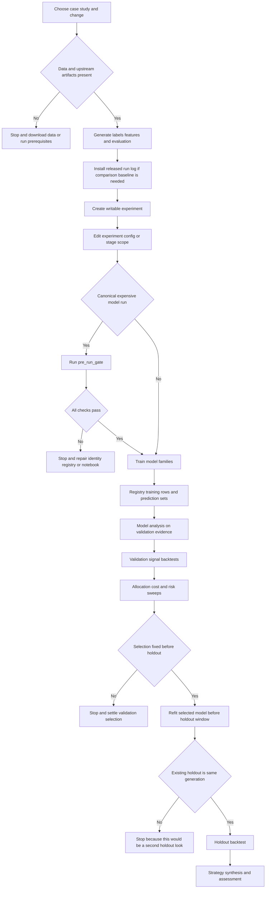

# Change and Run a Case Study Safely

A case study is an artifact pipeline, not a collection of independent notebooks. Labels and features feed content-addressed model runs; predictions feed validation backtests; allocation, cost, and risk sweeps narrow the field; only the validation-selected carrier is refit for holdout; synthesis reads the resulting registry and artifacts. The exact numbered files vary by market, so use the case study's `README.md` as the stage manifest rather than copying ETF stage numbers blindly ([case-study overview](../../case_studies/README.md), [ETF stage table](../../case_studies/etfs/README.md)).

This workflow complements [Research Integrity](../concepts/research-integrity.md), [Research Runtime](../architecture/research-runtime.md), [Artifact Registry](../architecture/artifact-registry.md), [Data and Path Runtime](../architecture/data-and-path-runtime.md), and [Test System](../testing/test-system.md).

## End-to-end control and artifact flow



*The handoffs are generated files and registry identities; each stop prevents a missing prerequisite, mixed registry, or invalid second look from becoming evidence.*

The common phase order is feasibility → labels → financial and model-based features → feature evaluation → linear baseline → available model families → cross-family analysis → validation backtest → allocation/cost/risk sweeps → holdout refit and backtest → synthesis. Some studies omit or add model families, and stage numbers differ. In ETFs, for example, stages `11a`–`11e` produce latent-factor runs while `11_latent_factors` only summarizes them; the full concrete sequence and outputs are in the [ETF README](../../case_studies/etfs/README.md).

## 1. Classify the change before editing

Choose the narrowest owner that expresses the intended change:

| Intended change | Edit here | Why / caution |
|---|---|---|
| Universe, cadence, execution defaults, cost model, label protocol, CV/holdout windows, feature declarations, or Ch16–19 sweep economics | `case_studies/{cs}/config/setup.yaml` in the experiment | This is the case-study trading and evaluation contract. A protocol change can invalidate labels, features, folds, and downstream evidence, not merely the next stage. |
| Which named model configurations run for one label and family | `case_studies/{cs}/config/training/{label}.yaml` in the experiment | This is a label-specific menu. Adding/removing an entry changes population membership. |
| Hyperparameters behind one reusable named configuration | `case_studies/config/{model_type}/{name}.yaml` in the experiment | Shared presets are resolved by name and can be reused across studies. Prefer a new preset name when comparing against an existing configuration. |
| Runtime scope, preview reductions, notebook population name, forced backtest refresh, or a documented stage-owned override | Tagged `# %% tags=["parameters"]` cell | These are execution controls, not usually strategy economics. A narrowed model population needs its own `POPULATION_NAME`; a reduced universe belongs in a preview workspace. |
| Behavior common to multiple studies or families | Shared runner/runtime, with focused tests | This changes all callers and may change identity, caching, preprocessing, or registration semantics. Do not patch one notebook to mask a runner defect. |

The three normal configuration layers are `setup.yaml`, the per-label training menu, and shared model presets. For example, the ETF `fwd_ret_21d` menu lists linear, GBM, deep-learning, latent-factor, and DML preset names; it does not contain the implementations ([training menu](../../case_studies/etfs/config/training/fwd_ret_21d.yaml)). Model stages resolve these declarations against data before fitting, and the linear runner writes each completed configuration independently, allowing a failed population run to resume rather than discard completed configurations ([linear stage](../../case_studies/etfs/06_linear.py)).

### Known precedence exceptions

Do not assume every preset key wins. Current known exceptions are:

- `09_dl_lstm.py` and `10_dl_tsmixer.py`: stage `N_EPOCHS`, `BATCH_SIZE`, and `LOOKBACK` override preset `n_epochs`, `batch_size`, and `params.lookback`.
- `08_tabular_dl.py`: stage `N_EPOCHS` and `BATCH_SIZE` override the preset.
- `11c_conditional_autoencoder.py` and `11e_supervised_autoencoder.py`: stage `N_EPOCHS = 50` overrides preset epochs.
- `12_causal_dml.py`: the stage parameter cell owns `n_folds`, `n_placebo`, `max_samples`, and `seed`.
- CPU GBM runs: the runtime seed is applied below `07_gbm.py` by the shared GBM runner and wins over `params.seed`.
- Deep-learning menus are filtered by `params.architecture` in each architecture-specific stage; latent-factor notebooks request their fixed model; causal DML takes only the first listed preset. A menu entry that is never dispatched creates no run and no hash.

If a value appears ignored, search assignments after `load_configs` or the equivalent loader. Treat this list as known exceptions, not a guarantee that no other override exists.

### Repository-pinned declarations

Four methodology declarations intentionally do **not** behave like ordinary experiment knobs:

- `labels.rebalance_step`
- `labels.classification_eval_label`
- `universe.cost_feasible`
- `backtest.sweep.htm_cost_cascade.liquid_quantile` (fixed at `0.20` because readers currently disagree)

They are read from repository `setup.yaml` even under `ML4T_OUTPUT_DIR`. Editing the experiment copy does nothing. Editing the repository copy requires an empty run log because these values do not reach `backtest_hash`; otherwise old rows may be silently reused under the changed methodology. `config/backtest/base.yaml` is a different, partly pinned exception: engine fields are hash inputs, but the price loader may consult the experiment copy. Treat it as read-only to avoid loading data under one interpretation and running the engine under another. These exceptions and their rationale are maintained in [Running Notebooks](../../docs/running-notebooks.md#declarations-that-always-come-from-the-repository).

A cadence change deserves special care: backtesting can apply a new `decision.cadence` to existing predictions, but the corresponding repository-pinned `labels.rebalance_step` must remain compatible with cadence and label horizon. This is not a safe one-file experiment edit.

## 2. Establish prerequisites and a baseline

Run commands from the repository root. Download required market data first; stage errors name missing upstream files. Generate prerequisites in order. For ETFs, a model-stage experiment normally needs:

```bash
uv run python case_studies/etfs/02_labels.py
uv run python case_studies/etfs/03_financial_features.py
uv run python case_studies/etfs/04_model_based_features.py
```

Run feasibility first when universe eligibility or feasibility evidence is changing, and run evaluation after changing labels or features. Do not assume a downloaded artifact bundle includes the modeling dataset: the bundle supplies the accepted `run_log/`, while `labels/` and `features/` are generated locally.

For a released comparison baseline:

```bash
uv run python scripts/download_artifacts.py --cs etfs
```

The installed release includes the registry and the training, prediction, and backtest artifacts it references. It is a snapshot, not a promise that a fresh run will be bitwise identical: code, libraries/hardware, and vendor data can move results. Keep conclusions tied to the current registry and interval evidence rather than copying a metric into prose.

## 3. Create and activate a writable experiment

Never train into a downloaded release baseline. Snapshot it and all available generated prerequisites:

```bash
uv run python scripts/create_experiment.py \
  --cs etfs \
  --output /tmp/ml4t-etf-experiment
```

The script creates `/tmp/ml4t-etf-experiment/etfs`, copies available `run_log`, `labels`, `features`, `evaluation`, and `benchmark`, copies the case-study config, seeds shared presets at `/tmp/ml4t-etf-experiment/config`, renames `run_log/.release` to `.baseline`, and makes only the copy writable. Creation uses staging and atomic renames; it refuses an existing target and, by default, requires an installed non-symlinked release run log ([implementation](../../scripts/create_experiment.py), [tests](../../tests/test_create_experiment.py)).

Edit the copies, then route **every** stage in the experiment through the same root:

```bash
$EDITOR /tmp/ml4t-etf-experiment/etfs/config/training/fwd_ret_21d.yaml
$EDITOR /tmp/ml4t-etf-experiment/config/lgb/leaves_63_mse.yaml
$EDITOR /tmp/ml4t-etf-experiment/etfs/config/setup.yaml

ML4T_OUTPUT_DIR=/tmp/ml4t-etf-experiment \
  uv run python case_studies/etfs/07_gbm.py
```

`ML4T_OUTPUT_DIR` redirects output **and** model/sweep config reads. Pointing it at an empty directory fails because neither redirected config nor modeling prerequisites exist. Open the study/activate the workspace before constructing registry readers or paths; otherwise one object can read the release registry while another writes the experiment registry.

## 4. Rehearse, verify identity, then run

For fast iteration, use the stage's parameters cell or Papermill overrides in a preview workspace. Keep the same code path; do not introduce a `TEST` branch. Reduced scope must not enter the canonical registry. ETF `14_backtest`, for example, refuses `MAX_SYMBOLS` on the canonical tier because a narrowed portfolio could otherwise compete with full-universe Sharpe; its traded-universe declaration is part of the reduced run's identity ([backtest stage](../../case_studies/etfs/14_backtest.py)).

Before an expensive **canonical model** run, execute the gate:

```bash
uv run python scripts/pre_run_gate.py \
  --case-study etfs \
  --family linear \
  --label fwd_ret_21d \
  --notebook 06_linear \
  --json /tmp/etfs-linear-gate.json
```

Do not touch a canonical run log unless the gate passes. It checks that:

1. the canonical registry exists, is writable, and migrates to required tables;
2. the `.py` and `.ipynb` pair exists, and external prose/conformance checkers are available and pass;
3. any `SUPERSEDES_*` declaration names a live generation;
4. the training menu declares configurations;
5. batch planning and per-request resolution produce the same, distinct identities;
6. for linear runs, folds prepare with the declared features and reuse behavior is measured;
7. a reduced population fits end to end in a throwaway workspace;
8. fitted rows record elapsed time, peak memory, machine use, and complete population rows; and
9. the canonical run has a measured or explicitly extrapolated cost.

The gate exits nonzero on failure and restores the canonical study after the throwaway preview ([gate implementation](../../scripts/pre_run_gate.py)). `--skip-preview` exists for debugging, not approval: it skips the substantive end-to-end check.

### Identity, rerun, and reuse rules

A resolved specification determines the training hash. A changed resolved config receives a new hash and row; an unchanged rerun reuses registered work. During model population execution, completed configurations remain registered if a later one fails, and a rerun fits only missing work. Backtests likewise hash prediction identity plus serialized strategy specification, skip existing combinations, and resume an interrupted sweep. `FORCE_REBACKTEST` should be used only when deliberately replacing/revalidating cached execution under an understood identity policy—not as a cure for an edit that failed to reach the hash.

A new hash is a cache-key change, not proof that the model consumed the intended value. Conversely, an undispatched menu entry produces no hash. Inspect the resolved plan and recorded specification before interpreting results.

## 5. Run downstream in evidence order

Use the case study README's exact files, but preserve these boundaries:

1. **Feasibility, labels, and features:** regenerate from the first affected upstream stage. A label/window/universe change can require all downstream state to be rebuilt.
2. **Model families:** run the declared populations. Linear is the baseline; run only families that apply to the market.
3. **Model analysis:** compare live, published validation prediction sets and fold/checkpoint behavior. Do not select on holdout.
4. **Validation backtest:** backtest live population members on `split='validation'`. The ETF stage filters retired population generations and stops if no current published prediction exists. It first runs a random-signal plumbing falsification and stops on implausible Sharpe.
5. **Allocation, costs, and risk:** advance only the configured top-N from the prior stage and sweep declared allocators/cost grids/overlays. These stages are still validation selection, not holdout evidence. ETF `setup.yaml` centralizes the advancement counts, concentration grid, allocator list, cost regimes, and position overlays ([setup](../../case_studies/etfs/config/setup.yaml)).
6. **Holdout prediction:** resolve the validation-selected carrier, preserve its checkpoint, refit on history ending before holdout with the label buffer, and register a holdout prediction.
7. **Holdout backtest:** trade that prediction with sizing, costs, and overlay already settled.
8. **Synthesis:** read the experiment registry with the same `ML4T_OUTPUT_DIR`; produce assessment/tearsheet outputs without inventing a second selector.

Example final read:

```bash
ML4T_OUTPUT_DIR=/tmp/ml4t-etf-experiment \
  uv run python case_studies/etfs/20_strategy_analysis.py
```

The ETF analysis explicitly restricts itself to live validation population members and stops if model/backtest prerequisites are absent ([strategy analysis](../../case_studies/etfs/20_strategy_analysis.py)).

## 6. Protect the holdout boundary

The holdout stage derives its winner from validation-stage results; no holdout observation participates in selection. It carries the chosen checkpoint, derives the holdout window from `setup.yaml`, ends training before the window by the label buffer, and recomputes fold-dependent quantities for the holdout refit.

Re-running the **same** deterministic holdout generation is idempotent and may reuse its identity. Changing the selected configuration after a holdout result exists is not a harmless replacement: it is a second look. ETF `18_holdout_predictions.py` stops on an existing different holdout generation, on a prediction whose training split cannot be attributed, or on a validation-fitted model mislabeled as holdout. Deleting rows does not erase the information already observed; retirement must use the registry lifecycle and the resulting claim must disclose the second look ([holdout stage](../../case_studies/etfs/18_holdout_predictions.py)).

## Focused validation after a change

- **Experiment/path changes:** `uv run pytest tests/test_create_experiment.py -v`; also exercise routing tests when changing `ML4T_OUTPUT_DIR` behavior.
- **Notebook parameters:** run the notebook-specific Papermill test or ETF subset. `tests/overrides.yaml` supplies reduced parameters, while helper tests reject unknown or overwritten override names.
- **Config or identity changes:** inspect the resolved model plan, run `pre_run_gate.py`, and verify the new registry row's spec and artifact paths—not just its hash.
- **Backtest/runtime changes:** run the plumbing falsification, a reduced preview sweep, and focused registry/hash tests before a canonical sweep.
- **Shared runner changes:** test at least two representative case studies or families plus resume/cache behavior; the extension boundary is shared by design.
- **Holdout or synthesis changes:** use an isolated copied registry and assert refusal paths for different-generation, unattributable, and validation-fitted holdout rows. Never use the real unseen period as a debugging loop.

## Failure checklist

Stop rather than improvise when any of these occurs:

- missing label, feature, benchmark, prediction, or registry artifact;
- experiment config absent under `ML4T_OUTPUT_DIR`;
- a narrowed population has no distinct population name;
- a preset edit is shadowed by a stage/runtime override;
- a repository-pinned declaration was edited only in the experiment;
- an identity changed unexpectedly—or failed to change for a hash-covered change;
- the gate reports mismatched identities, stale supersession, missing runtime evidence, or uncosted work;
- no current published prediction population remains for backtesting;
- random-signal plumbing falsification fails;
- validation selection is not fixed before holdout; or
- a different configuration has already been evaluated on the declared holdout window.
