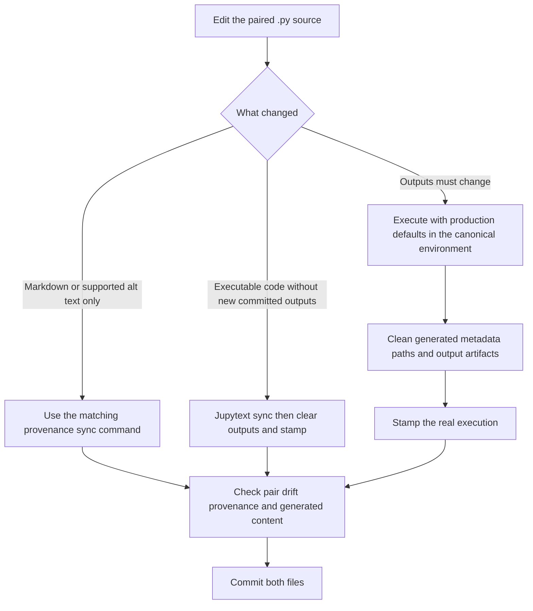

# Edit, Execute, and Synchronize Notebooks

A repository notebook is a pair with deliberately unequal roles:

- `<name>.py` is the **authorial source**. Edit this file.
- `<name>.ipynb` is the **generated, viewable artifact**. It carries the rendered cells and may carry outputs from a real execution. Do not hand-edit it.

The source uses Jupytext's percent format. `# %%` begins a code cell, `# %% [markdown]` begins a markdown cell whose content is comment-prefixed, and marker metadata such as `tags=["parameters"]` is part of the cell definition. A marker, tag, cell boundary, final expression, or trailing semicolon can affect execution or display; these are not merely formatting.

This workflow complements the repository overview in [Repository System](../architecture/repository-system.md), the CI context in [Environments and CI](../operations/environments-and-ci.md), and the notebook integration-test design in [Test System](../testing/test-system.md).

## The lifecycle at a glance



*The safe contribution path depends on whether the existing execution remains truthful after the source edit.*

The key decision is not whether a diff looks small. It is whether the committed outputs are still exactly the results of the current executable source.

## Author cells and runtime parameter cells

Every notebook has a tagged parameter cell containing **production defaults**:

```python
# %% tags=["parameters"]
MAX_SYMBOLS = 0
N_EPOCHS = 500
START_DATE = "2006-01-01"
```

These defaults define what readers see and what a production execution means. Tests accelerate the same program by asking Papermill to insert an `injected-parameters` cell immediately after this cell. The injected assignments override selected values, but they are runtime artifacts—not authorial cells and not content to copy into the `.py`:

```python
# Injected by Papermill
MAX_SYMBOLS = 15
N_EPOCHS = 2
```

Keep the parameter names reachable below the injection point and do not unconditionally overwrite them before first use. `tests/overrides.yaml` supplies reduced values, while the parameter-reachability tests reject unknown, invisible, or overwritten overrides. Do not add a parallel `if TEST:` implementation: production and reduced tests must follow the same code path.

A reduced Papermill run is useful for validation but normally is **not** a publishable execution. The provenance code treats an override as production-safe only when it is explicitly allowlisted and preserves the full execution surface, such as cache-bypass flags with their required values or identity declarations validated by their consumer. An arbitrary `MAX_SYMBOLS`, `MAX_FOLDS`, or sample-fraction override makes the run non-production.

Papermill's notebook-level `metadata.papermill.parameters` is not authoritative because it can survive a later unparameterized run. At stamp time, the executor must explicitly declare either `--production` or the actual `--parameters` JSON. If an `injected-parameters` cell is present, the stamper cross-checks that declaration and refuses a contradiction.

## Choose the path that matches the change

### Prose-only changes

For markdown wording, markdown-cell insertion/deletion/merging, or markdown retagging, edit the `.py` and run:

```bash
uv run python .github/scripts/notebook_provenance.py sync-prose <notebook>.py
```

`sync-prose` compares every code cell with the source blob named by the existing stamp. Only if those executable cells—including markers and tags—are unchanged does it use Jupytext's update mode to fold the new prose into the `.ipynb`. It checks output counts per code cell, keeps the original `executed_at` and `executor`, advances the source blob, and records that the prose was synchronized without execution.

This is safer than relying on plain `jupytext --sync`. A simple in-place wording edit may happen to survive ordinary synchronization, but adding, deleting, merging, or retagging markdown cells changes the source blob and cell shape. Without `sync-prose`, the execution stamp still describes the earlier source and the provenance gate can reject the render.

For a figure-alt correction, use the narrower command:

```bash
uv run python .github/scripts/notebook_provenance.py sync-alt <notebook>.py
```

It updates both the source and rendered output metadata while preserving image bytes, and refuses unrelated executable drift. Do not substitute `sync-prose`: an alt string used by code is in a code cell.

Other output-preserving commands exist for mechanically recognizable cases: `sync-paths` for exactly the path sanitizer's rewrite, `sync-plotly` for the supported Plotly-payload strip, and `sync-imports` for removal of demonstrably unreferenced imports. `sync-inert --reason ...` is a last-resort maintainer assertion, not a general shortcut around execution. Use only the command whose preconditions actually describe the edit.

### Code changes without committed replacement outputs

For executable changes, synchronize source forward:

```bash
uv run jupytext --sync <notebook>.py
uv run python .github/scripts/notebook_provenance.py clear <notebook>.ipynb
```

`clear` removes outputs and `metadata.ml4t_provenance`. This creates the one legal unexecuted state: no outputs and no claim that an execution occurred. It is appropriate when the canonical reference-data environment will execute the notebook later. Say this explicitly in the pull request.

Do not keep old outputs beneath changed code, and do not merely delete the stamp while retaining outputs. A previously stamped notebook is guarded against silent de-stamping, and an unstamped notebook with results is not equivalent to a cleared artifact.

`scripts/sync_notebooks.py` can classify content drift independently of unreliable filesystem times:

```bash
uv run python scripts/sync_notebooks.py --check <notebook>.py
```

It compares code and prose cells, ignores Papermill-injected code cells, and reports doc-only drift, code drift with outputs, code drift without outputs, or reverse drift. Its default update mode preserves existing outputs when cell structure permits, but **code drift with outputs is not safe merely because Jupytext can preserve them**. Those outputs are stale until the changed code is executed. `--safe-only` skips that category. If the `.ipynb` appears newer and differs, the script stops forward overwrite for manual review; inspect and recover any notebook-only work into the `.py` rather than losing it.

### Changes that require new committed outputs

If the correction changes a calculation, displayed value, emitted table, figure, or other executed result, re-execute the synchronized notebook against production data and defaults in the canonical environment. A local reduced Papermill run proves that code can run; it does not establish publishable output provenance. Contributors should not commit a notebook re-executed on an arbitrary workstation.

The execution/restamping path is conceptually:

```bash
uv run jupytext --sync <notebook>.py
# Execute in the notebook's canonical environment with production defaults.
uv run python .github/scripts/sanitize_notebook_paths.py <notebook>.ipynb
uv run python .github/scripts/strip_empty_cell_tags.py <notebook>.ipynb
uv run python .github/scripts/notebook_provenance.py stamp <notebook>.ipynb \
  --executor <canonical-environment> --production
```

Use the repository's canonical execution automation where available rather than treating this sketch as a replacement for environment-specific launch logic. A parameterized canonical run must declare its real override set with `--parameters '<json>'` instead of `--production`; only production-safe values receive a production stamp. The stamper should see Papermill's injected cell when it cross-checks a parameterized run. Generated Papermill fossils can then be removed by the canonical workflow without incorporating the injected assignments into the authorial `.py`.

The stamp records:

- `source_py_blob`: the exact paired source at execution time;
- `outputs_digest`: the parsed outputs produced by that run, excluding execution counters, figure alt text, and the injected-parameters cell;
- `library_digest`: the transitive repository-local code imported by the notebook, keyed by path and content;
- execution time, executor, declared parameters, production status, and optional notes.

The gate fails stale source, changed stamped outputs, non-production runs, contradictions with injected parameters, and **hollow** stamps over a notebook with no evidence that code ran. Library drift is reported as an advisory because helper-code changes can invalidate interpretation even when the notebook source itself did not move. Older unstamped notebooks remain advisory unless strict checking is requested, but once a notebook is stamped the stamp may not silently disappear.

## Generated-content hygiene

Execution creates more than numeric outputs. Before committing an executed artifact, check all of these surfaces:

1. **Machine paths.** `sanitize_notebook_paths.py` rewrites machine-specific paths in notebook metadata, cell metadata, and textual outputs. It deliberately never changes cell source and never rewrites base64 image/PDF payloads. Repository roots become repository-relative paths, user-home paths become generic `~` forms, and unstable scratch roots become `~/scratch/`. If the same leaked string appears in source, the sanitizer refuses the ambiguous raw-text rewrite; remove it by hand when safe or re-execute.
2. **Cell tags.** Papermill can add empty `"tags": []` metadata. The paired Jupytext configuration tracks tags, so a one-sided empty list can make JupyterLab report a file-load error. `strip_empty_cell_tags.py` removes only empty notebook-side lists and preserves non-empty `parameters` and `injected-parameters` tags. It skips pairs whose `.py` intentionally carries the same `tags=[]` fossil, because pair agreement is the invariant.
3. **Output rendering.** Hygiene tests reject undecodable binary payloads and reader-hostile Plotly output shapes. Headless `PLOTLY_RENDERER=json` is suitable for execution tests but can leave a bare JSON figure that GitHub cannot render; canonical reader-facing output needs the supported static/renderable form.
4. **Code and prose drift.** `sync_notebooks.py --check` compares both surfaces. It normalizes only cell-terminating newlines in prose, preserving indentation and Markdown hard breaks because they affect rendering.
5. **Provenance.** Run the targeted provenance check after generated cleanup. If cleanup changes stamped outputs, use the matching surgical sync command or restamp the actual cleaned execution as required; never hand-adjust a digest.

## Narrow validation recipes

Run commands from the repository root. Replace `<notebook>` with the path without an extension where convenient.

### Prose-only or supported alt-text change

```bash
uv run python .github/scripts/notebook_provenance.py sync-prose <notebook>.py
# Use sync-alt instead for a figure-alt correction.
uv run python scripts/sync_notebooks.py --check <notebook>.py
uv run python .github/scripts/notebook_provenance.py check <notebook>.py <notebook>.ipynb
uv run pytest tests/test_notebook_prose_sync.py tests/test_notebook_surgical_edits.py
```

The sync command itself is the important guard: it refuses executable drift and verifies output preservation. Review the resulting `.ipynb` diff to ensure it contains the intended prose/render update and provenance-note change, not regenerated results.

### Code change, no replacement outputs committed

```bash
uv run jupytext --sync <notebook>.py
uv run python .github/scripts/notebook_provenance.py clear <notebook>.ipynb
uv run python scripts/sync_notebooks.py --check <notebook>.py
uv run python .github/scripts/notebook_provenance.py check <notebook>.py <notebook>.ipynb
uv run pytest tests/test_notebook_sync.py
```

Also run the focused unit or notebook test that demonstrates the defect. A reduced notebook integration run can be selected by name:

```bash
uv run pytest tests/test_chapter_notebooks.py -v -k "<notebook-stem>"
```

That test executes a temporary notebook through Papermill and does not turn its reduced outputs into committed reader-facing output.

### Executed-output change

After canonical production execution and stamping:

```bash
uv run python .github/scripts/sanitize_notebook_paths.py --check <notebook>.ipynb
uv run python .github/scripts/strip_empty_cell_tags.py --check <notebook>.ipynb
uv run python scripts/sync_notebooks.py --check <notebook>.py
uv run python .github/scripts/notebook_provenance.py check <notebook>.py <notebook>.ipynb
uv run pytest \
  tests/test_notebook_provenance_digests.py \
  tests/test_notebook_output_hygiene.py \
  tests/test_notebook_sync.py
```

For a changed number, record the old value, new value, and how each was produced. Output correctness outranks diff cleanliness: do not clear or regenerate valid outputs merely to make a smaller diff, and do not retain a known-wrong committed result.

## Common failure modes

| Symptom | Meaning and response |
|---|---|
| `STALE` | The `.py` no longer hashes to the stamped source. Use the appropriate surgical sync only for a recognized non-computational edit; otherwise execute/restamp or clear. |
| `OUTPUTS CHANGED` | The notebook's outputs no longer match the stamp. Restore them, use the exact supported generated-output sync, or restamp a real execution. |
| `TEST-MODE` | Reduced parameters produced the committed artifact. Re-run with production defaults or production-safe declared parameters. |
| `CONTRADICTED` | The declared stamp parameters disagree with Papermill's injected cell. Do not relabel the run; execute with the intended parameters. |
| `HOLLOW` | A stamp claims an execution but code cells show neither outputs nor execution counts. Run the notebook; do not stamp a render. |
| `LIBRARY DRIFT` | Imported repository helpers changed after execution. It is advisory, but re-execute when those changes can affect the displayed result. |
| Reverse `.ipynb` drift | Someone may have edited only the generated artifact. Review and port intended work to `.py`; do not blindly overwrite either side. |
| JupyterLab file-load error | Check one-sided empty tag metadata and pair drift before assuming the notebook JSON is corrupt. |

Finally, do not “fix” code under a vendored `_reference` directory while formatting or synchronizing nearby notebooks. Ruff explicitly excludes `**/_reference/**` because that tree is upstream reference code. Treat it as vendored material; make repository-owned changes in the notebook or its supported helpers instead unless a separately justified vendor update is intended.
